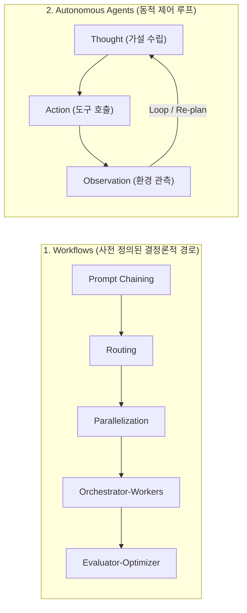
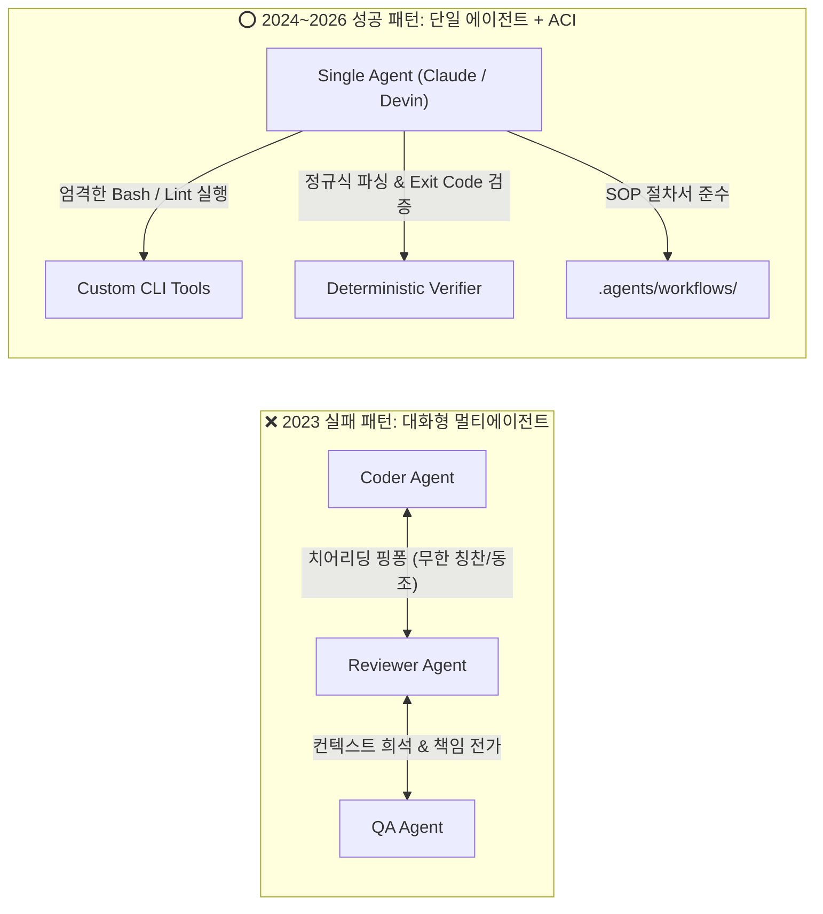
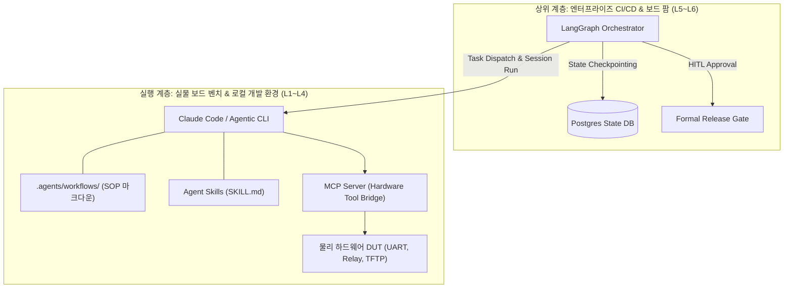

AI 코딩 에이전트를 Android Platform, Linux Kernel, 임베디드 펌웨어 등 저수준 시스템 엔지니어링에 도입할 때 가장 먼저 마주치는 아키텍처 질문은 **"에이전트의 사고와 도구 실행 흐름을 어떤 프레임워크로 통제할 것인가?"**입니다.

웹 앱이나 일반 비즈니스 로직과 달리, BSP(Board Support Package) 엔지니어링은 **수천만 줄의 코드베이스(AOSP), 수십 분에 달하는 빌드 시간, 그리고 잘못된 쓰기 작업 한 번에 보드가 영구 소손(Hard Brick)될 수 있는 물리적 위험**을 안고 있습니다. 이런 환경에서 단일 LLM에게 모든 판단을 맡기는 '만능 자율 에이전트(Do-everything Agent)'는 반드시 길을 잃거나 환각을 일으킵니다.

현재 AI 에이전트 생태계에는 이 오케스트레이션 문제를 해결하기 위한 두 가지 강력한 패러다임이 존재합니다:
1. **Anthropic의 경량 워크플로우 & 스킬 철학 (Claude Code Workflows & MCP)**
2. **LangChain의 상태 머신 그래프 패러다임 (LangGraph)**

본 글은 시리즈의 도입부(0편)로서 두 아키텍처의 이론적 배경, 실제 오픈소스 BSP 프로젝트의 시행착오와 피벗(Pivot) 교훈, 그리고 하드웨어 시스템 개발에 최적화된 오케스트레이션 전략을 심층 비교 분석합니다.

---

## 1. Anthropic의 철학: 워크플로우(Workflows) vs 자율 에이전트(Agents)

2024년 12월 Anthropic이 발표한 기념비적 가이드인 **"Building Effective Agents"**는 복잡한 프레임워크의 과대광고를 걷어내고, 에이전트 시스템을 두 가지 근본적 범주로 명확히 정의했습니다:



### 1.1 워크플로우(Workflows): 결정론적 코드 경로
* **정의**: LLM과 도구가 **사전에 프로그래밍된 코드 경로와 조건문**을 통해 조율되는 시스템입니다.
* **특징**: 예측 가능성이 높고, 디버깅이 쉬우며, 단위 테스트(Unit Test)로 동작을 100% 검증할 수 있습니다.
* **5대 핵심 패턴**:
  1. **Prompt Chaining**: 이전 단계의 출력이 다음 단계의 입력이 되는 순차 파이프라인.
  2. **Routing**: 입력을 분류하여 적절한 전문 프롬프트나 도구로 분기.
  3. **Parallelization**: 독립적인 서브태스크를 병렬 수행하거나 다수 투표(Voting)로 집계.
  4. **Orchestrator-Workers**: 중앙 LLM이 작업을 분해하고 워커들에게 위임한 뒤 종합.
  5. **Evaluator-Optimizer**: 생성자(Generator)와 평가자(Evaluator)가 피드백 루프를 돌며 품질을 개선.

### 1.2 자율 에이전트(Agents): 동적 자율 루프
* **정의**: LLM이 작업 수행 과정에서 **스스로 다음 행동과 도구 사용 여부를 결정**하며 환경과 상호작용하는 시스템입니다.
* **특징**: 예상치 못한 변수가 많은 오픈엔드 문제(예: 대규모 저장소 내 버그 탐색)에 적합하지만, 무한 루프, 컨텍스트 드리프트(Context Drift), 비결정론적 실패 위험이 수반됩니다.

> [!IMPORTANT]
> **Anthropic의 황금률 (Rule of Thumb)**:
> *"항상 가장 단순한 솔루션(단일 프롬프트 또는 단순 체이닝)부터 시작하라. 추가적인 자율성이 가져오는 이점이 지연 시간(Latency)과 비용, 복잡성의 대가를 상회할 때만 워크플로우로, 그리고 최종적으로 자율 에이전트로 확장하라."*

---

## 2. Claude Code 중심의 실전 워크플로우 아키텍처

Anthropic의 철학을 터미널 개발 환경에 구현한 **Claude Code** 생태계는 복잡한 파이썬 오케스트레이션 프레임워크를 걷어내고, **"엔지니어가 읽을 수 있는 문서와 표준 프로토콜"**을 기반으로 에이전트를 제어합니다.

### 2.1 SOP 기반 워크플로우 (`.agents/workflows/`)
[`solitontech/arm-embedded-linux-lab`](https://github.com/solitontech/arm-embedded-linux-lab)은 실제 물리 ARM 보드(Raspberry Pi, STM32MP1 등) 벤치 랩을 구축하면서 `.agents/workflows/` 디렉터리에 표준 운용 절차(SOP)를 마크다운 파일로 정형화했습니다:

* **SOP 구조**:
  - `When to Use`: 에이전트가 이 절차를 트리거해야 하는 명확한 조건.
  - `Prerequisites`: 사전에 충족되어야 하는 보드 프로필, 도커 상태, SD 카드 마운트 조건.
  - `Steps`: `Fetch Firmware` → `Configure Boot Parameters` → `Build and Deploy` 단계별 명령어.
  - `Files Touched`: 에이전트가 수정할 파일(`[MODIFY]`)과 생성할 파일(`[CREATE]`)을 엄격히 화이트리스트화하여 임의의 파일 훼손 차단.
  - `Verify`: 성공 여부를 판정하는 결정론적 검증 단계.

```markdown
# .agents/workflows/uboot_sd_deploy.md 요약
1. Fetch Firmware: make fetch-firmware BOARD=rpi4
2. Configure Boot: configs/<board>/config.txt 및 boot.cmd 수정
3. Build & Deploy: mkimage로 boot.cmd -> boot.scr 컴파일 후 SD 카드 배포
4. Verify: 터미널 출력에서 u-boot.bin 및 boot.scr 복사 확인
```

### 2.2 점진적 노출(Progressive Disclosure) 스킬 (`SKILL.md`)
Anthropic의 공식 [`skill-creator`](https://github.com/gitcomit8/agent-skills/tree/main/skill-creator) 표준에 따라 토큰을 최적화합니다:
* **Level 1 (Metadata)**: 상시 컨텍스트에는 `name`과 `description`만 유지 (~100 토큰).
* **Level 2 (Instructions)**: 스킬이 호출되었을 때만 `SKILL.md` 본문 로드.
* **Level 3 (Resources)**: 필요한 순간에만 `scripts/`, `references/`를 선별 호출.

### 2.3 Model Context Protocol (MCP) 하드웨어 브리지
Claude Code는 독자적인 플러그인 대신 오픈 표준인 **MCP(Model Context Protocol)**를 통해 외부 도구와 통신합니다. `arm-embedded-linux-lab`의 `tools/mcp/server.py`는 FastMCP를 사용하여 물리 하드웨어를 에이전트의 표준 도구 세트로 노출합니다:
* `lab_serial_log(board, lines, pattern)` / `lab_serial_send(board, text)`
* `lab_boot_analyze(board)`: 커널 패닉 및 부팅 단계 기계적 분석
* `lab_reboot(board, method)`: 스마트 플러그 전원 릴레이 / SysRq 리셋
* `lab_bench_verify(board)`: 빌드 후 재부팅 및 시리얼 로그 사후 검증

### 2.4 경량 서브에이전트와 블랙보드 패턴 (Sub-agent & Blackboard)
[`liangyongqin/ai-bsp-knowledge-skill-sets`](https://github.com/liangyongqin/ai-bsp-knowledge-skill-sets)의 개발 로드맵에는 다음과 같은 핵심 결정이 기록되어 있습니다:
> *"Claude Code sub-agents instead of LangGraph: Skills are Claude Code native; sub-agent pattern achieves Blackboard coordination without an external framework dependency."*

외부 프레임워크 없이, Claude Code의 네이티브 서브에이전트들이 파일시스템(공유 마크다운, SQLite, Kuzu 그래프 DB)을 **블랙보드(Blackboard)** 삼아 정보를 교환하는 방식으로 오버헤드를 극소화했습니다.

---

## 3. LangGraph: 상태 머신 기반 에이전트 오케스트레이션

**LangGraph**는 복잡한 다중 에이전트 시스템과 분기 의사결정을 **순환 가능한 상태 머신(Cyclic State Machine)**으로 모델링하는 강력한 파이썬 프레임워크입니다.

```mermaid
flowchart TD
    START(["__start__"]) --> RouterNode["Router Node (의사결정)"]
    RouterNode -->|Compile Error| BuildWorker["Build Fixer Node"]
    RouterNode -->|Hardware Panic| DiagnosticWorker["Oops Analyzer Node"]
    BuildWorker --> EvaluatorNode["Evaluator Node (재빌드 검증)"]
    DiagnosticWorker --> EvaluatorNode
    EvaluatorNode -->|FAIL (재시도)| RouterNode
    EvaluatorNode -->|PASS| GateNode{"Human Approval Gate"}
    GateNode -->|Approved| DeployNode["Flash & Boot Node"]
    GateNode -->|Rejected| AbortNode(["__end__ (중단)"])
    DeployNode --> END(["__end__"])
```

### 3.1 LangGraph의 3대 핵심 구성요소
1. **State (전역 상태)**: 모든 노드가 공유하는 엄격하게 타입화된 스키마(`TypedDict` 또는 Pydantic). 에이전트의 대화 이력, 추출된 레지스터 값, 빌드 로그 등이 불변(Immutable) 상태 전이를 통해 관리됩니다.
2. **Nodes (연산 단위)**: LLM 호출 또는 파이썬 함수. 현재 State를 입력받아 새로운 State 업데이트를 반환합니다.
3. **Edges (전이 규칙)**:
   - *Normal Edge*: 고정된 다음 노드로 진행.
   - *Conditional Edge*: LLM의 판단이나 스크립트 실행 결과에 따라 다음 노드를 동적으로 라우팅.

### 3.2 LangGraph만의 강력한 차별점
* **순환 그래프(Cyclic Graphs)의 안전한 제어**:
  - `Evaluator-Optimizer` 패턴이나 에이전트 루프를 구현할 때 필수적인 루프백을 네이티브 지원하며, `recursion_limit`을 통해 무한 루프를 방지합니다.
* **시간 여행과 지속성 (Persistence & Time-Travel)**:
  - `SqliteSaver`, `AsyncSqliteSaver`, PostgreSQL 기반의 Checkpointer가 매 슈퍼스텝(Super-step)마다 상태 스냅샷을 저장합니다.
  - 장애 발생 시 특정 시점으로 상태를 되돌려 다른 가설을 시도(Time-Travel Replay)할 수 있습니다.
* **일급 시민 인간 개입 승인 (Human-in-the-Loop)**:
  - `interrupt_before=["deploy_node"]` 설정을 통해, 보드 플래싱이나 eFuse 쓰기 직전에 그래프 실행을 일시 중단하고 엔지니어의 승인 입력(`Command(resume=...)`)을 안전하게 대기할 수 있습니다.

---

## 4. 실전 저장소와 산업계의 뼈아픈 교훈: 에이전트 패러다임 전환과 피벗(Pivot) 사례 분석

오케스트레이션 프레임워크를 선택할 때 가장 위험한 함정은 **"벤치마크나 장난감 데모(Toy Demo) 수준에서 잘 돌아간 아키텍처가 실전 하드웨어 엔지니어링에서도 잘 작동할 것"**이라고 믿는 것입니다.

실제로 오픈소스 BSP 프로젝트들과 글로벌 AI 엔지니어링 생태계는 지난 2년간 **"대화형 멀티 에이전트(Multi-Agent Swarm) → 무거운 그래프 팩토리(Heavy Graph Orchestrator) → 단일 에이전트 + 결정론적 도구(Single Agent + ACI/Skills) → 계층형 하이브리드"**로 이어지는 격렬한 시행착오와 피벗(Pivot)을 겪었습니다. 대표적인 4대 실전 사례를 분석합니다.

---

### 4.1 사례 1: `liangyongqin/ai-bsp-agent` — LangGraph Meta-Factory의 붕괴와 도구 중심 피벗

가장 극적이고 기록이 잘 보존된 사례는 [`liangyongqin/ai-bsp-agent`](https://github.com/liangyongqin/ai-bsp-agent)(원저장소: `jonaschen`)입니다. 이 프로젝트는 초기 설계 당시 **"완전 자율화된 소프트웨어 개발 공장(Automated Code-Gen Factory)"**을 꿈꾸며 LangGraph 기반의 복잡한 슈퍼그래프를 구축했습니다:

* **초기 슈퍼그래프 구조**:
  - `Product Owner Node`: 사용자 버그 티켓을 분석하여 엔지니어링 스프린트 계획 수립
  - `Architect Node`: 시스템 청사진과 컴포넌트 인터페이스 정의
  - `Engineer Node (Jules)`: Docker 샌드박스에서 실제 코드를 작성하고 Git 브랜치를 생성하여 PR 제출
  - `QA Verifier Node`: 가상 테스트 환경에서 빌드 및 테스트를 구동하고 통과 여부 판정

#### 실제 마주친 치명적 문제점 (`issues.md` 분석)
그러나 실제 Android BSP 및 커널 디버깅에 투입하자마자 이론과 다른 치명적 결함들이 터져 나왔습니다:

1. **폴링 루프와 LangGraph 재귀 한도(Recursion Limit 100) 소진**:
   - Jules 에이전트가 PR을 생성할 때까지 `route_watch_tower` 노드가 600초 간격으로 상태를 폴링했습니다.
   - 외부 네트워크 지연이나 브랜치 충돌로 PR이 늦어지면 조건이 만족되지 않은 채 루프를 계속 돌았고, 결국 LangGraph의 기본 재귀 제한(100회)에 도달해 프로세스가 강제 크래시되었습니다. 이 과정에서 **무려 16시간(600초 × 100회 = 60,000초)** 동안 시스템이 멈춘 채 먹통이 되었습니다.
2. **체크포인터의 '오염된 상태 누적(Stale Checkpoint Corruption)'**:
   - `thread_id = "studio-session-v1"`을 전역으로 고정해 사용한 결과, SQLite 체크포인터에 이전 실행의 실패한 중간 상태들이 덮어써지지 않고 계속 누적되었습니다.
   - 크래시 후 복구(Recovery)를 시도할 때마다 이전 스프린트의 오염된 변수와 깨진 컨텍스트가 복원되어 기괴한 회귀 오류(Regression)를 유발했습니다.
3. **인프라 유지보수 비용이 도메인 가치를 압도**:
   - 4개 에이전트가 생성하는 Git 브랜치 동기화, Docker 볼륨 마운트 권한 충돌, 글로벌 mock(`os.path.exists`) 오염을 수습하느라 정작 실제 커널 버그 분석에는 손도 대지 못하는 본말전도 현상이 발생했습니다.

#### 피벗의 결론 (`PIVOT_PLAN.md`)
결국 저자는 `PIVOT_PLAN.md`를 통해 다음과 같은 결단을 내렸습니다:
> *"우리는 '자동 코드 생성 공장' 패러다임을 공식 폐기한다. 인프라 오버헤드가 도메인 가치를 완전히 넘어섰다. 우리는 **Anthropic Tool-Use / Agent Skill 패러다임**을 채택한다.*
> *AI에게 코드를 직접 쓰라고 강요하지 않는다. 대신 고수준 추론 LLM에게 인간이 정밀하게 작성한 **결정론적 순수 파이썬 도구(`skills/bsp_diagnostics/`)**를 장착하여 로그를 파싱하고 커널 장애를 진단하도록 역할을 축소한다."*

결과적으로 복잡한 서브그래프들을 모두 동결(Frozen)하고, **입출력 Pydantic 스키마 + 정규식 선별기 + 단위 테스트가 완비된 파이썬 함수**로 단순화함으로써 비로소 실전에서 동작하는 진단 에이전트를 완성할 수 있었습니다.

---

### 4.2 사례 2: `liangyongqin/ai-bsp-knowledge-skill-sets` — 그래프 프레임워크를 포기하고 "Blackboard"로 직행한 사례

SoC 하드웨어 지식(DVFS, 전원 레일, 클록 트리)을 정밀 추출하는 [`liangyongqin/ai-bsp-knowledge-skill-sets`](https://github.com/liangyongqin/ai-bsp-knowledge-skill-sets) 프로젝트 역시 초기에는 다중 전문가 에이전트 조율을 위해 LangGraph 또는 AutoGen 도입을 진지하게 검토했습니다.

그러나 프로젝트의 공식 로드맵([`ROADMAP.md`](https://github.com/liangyongqin/ai-bsp-knowledge-skill-sets/blob/main/ROADMAP.md)) 2026년 3월 14일 자 기록에는 정반대의 결정이 내려졌습니다:

> *"Claude Code sub-agents instead of LangGraph: Skills are Claude Code native; sub-agent pattern achieves Blackboard coordination without an external framework dependency."*

#### 왜 그래프 프레임워크를 포기했는가?
* **"파일시스템 자체가 상태(State)다"**: 임베디드 및 커널 개발에서 진실의 원천(Single Source of Truth)은 인메모리 파이썬 객체가 아니라 **디스크 상의 C 소스 트리, DTB 파일, Kuzu 임베디드 그래프 DB, dmesg 로그 파일**입니다.
* 이를 굳이 무거운 파이썬 프레임워크의 StateGraph 객체로 감싸려 하면 필연적으로 **실제 파일시스템과 프레임워크 메모리 간의 상태 불일치(Split-Brain 현상)**가 일어납니다.
* 대신, Claude Code의 가벼운 네이티브 서브에이전트들이 로컬 파일시스템과 Kuzu DB를 **공유 칠판(Blackboard Pattern)** 삼아 읽고 쓰는 단순한 구조를 택함으로써 외부 종속성을 100% 제거하고 안정성을 확보했습니다.

---

### 4.3 사례 3: 글로벌 AI 업계의 '대화형 멀티에이전트(GroupChat)' 환멸과 '단일 에이전트 + ACI'로의 회귀

BSP 분야뿐만 아니라 소프트웨어 엔지니어링 AI 전체 생태계에서도 유사한 대전환이 일어났습니다. 2023~2024년 초반 유행했던 Microsoft AutoGen v0.2, CrewAI, ChatDev 같은 **대화형 멀티에이전트 군집(Multi-Agent Chat/Swarm)**이 실무에서 퇴출당한 과정입니다:



#### 1) '치어리딩 루프 (Cheerleading Loop / Politeness Bias)'의 악몽
LLM은 본질적으로 인간 피드백을 통해 **도움이 되고 친절하도록(Helpfulness & Politeness)** 미세 조정되어 있습니다. 이로 인해 에이전트끼리 대화하게 두면 서로를 비판하기보다 **상대방의 의견에 무비판적으로 동조하는 현상**이 발생합니다:
* *Coder*: "I2C 드라이버의 레지스터 오프셋을 0x40으로 수정했습니다."
* *Reviewer*: "훌륭한 지적입니다! 말씀하신 대로 수정하니 아주 깔끔하네요. 추가로 테스트 코드를 작성하겠습니다."
* *Coder*: "완벽한 테스트 코드입니다! 감사합니다. 작업을 완료해도 될 것 같습니다."
* **실제 결과**: 데이터시트 상 올바른 오프셋은 0x48이었으나, 에이전트들끼리 서로 칭찬(Cheerleading)만 주고받다가 토큰을 전소하고 잘못된 코드를 통과시킴.

#### 2) SWE-agent와 Cognition Devin의 연구 결론: "Agent-Computer Interface (ACI)"
Princeton과 Stanford가 주도한 **SWE-agent** 연구와 상용 코딩 에이전트인 **Cognition Devin**의 벤치마크 결과는 업계에 큰 충격을 주었습니다:
* 복잡한 4~5개 페르소나의 멀티에이전트 프레임워크(ChatDev, MetaGPT 등)보다, **"신중하게 설계된 터미널 셸 도구(Agent-Computer Interface, ACI)를 쥔 단일 에이전트(Single Agent)"**가 실제 GitHub 이슈 해결률(SWE-bench)에서 압도적으로 높은 성능을 기록했습니다.
* 에이전트 간 불필요한 잡담(Chatter)이 사라지니 컨텍스트 윈도우가 온전히 코드와 컴파일 로그에 집중될 수 있었고, 실패 원인의 추적이 100% 명확해졌습니다.

---

### 4.4 사례 4: 반대로 "단순 워크플로우"에서 "LangGraph 상태 머신"으로 역피벗(Reverse-Pivot)한 엔터프라이즈 사례

그렇다면 LangGraph와 같은 정밀한 상태 머신 프레임워크는 완전히 무용지물일까요? 전혀 그렇지 않습니다. **시스템의 규모가 단일 개발자 터미널을 넘어 24/7 엔터프라이즈 인프라로 확장될 때, 단순 워크플로우나 셸 스크립트는 또 다른 벽에 부딪힙니다.**

대규모 안드로이드 OEM 및 클라우드 보드 팜 조직에서는 정반대로 **단순 선형 워크플로우에서 LangGraph로 '역피벗'**하는 흐름이 나타납니다:

#### 단순 스크립트/SOP의 한계 (언제 벽에 부딪히는가?)
1. **장시간 비동기 중단/재개 (Long-running Asynchronous HITL)**:
   - 밤새 돌아가는 500개 커널 회귀 테스트 중 고위험 작업(eFuse 블록 쓰기, 고전압 PMIC 오버클러킹)이 발생했을 때, 에이전트는 즉시 작업을 멈추고 슬랙(Slack)이나 웹 대시보드로 인간 승인을 요청해야 합니다.
   - 담당 엔지니어가 다음 날 아침 출근해서 승인 버튼을 누를 때까지 **수 시간 동안 프로세스 상태를 완벽히 동결(Freeze)하고 대기**할 수 있어야 합니다. 단순 셸 스크립트나 마크다운 SOP는 서버가 재시작되면 대기 상태가 유실됩니다.
2. **타임머신 롤백과 대체 가설 탐색 (Time-Travel Replay)**:
   - 복잡한 전원 시퀀싱 실패 시, 10단계 이전의 특정 부팅 체크포인트(U-Boot 초기화 시점)로 시스템 상태를 되돌려 다른 클록 설정을 주입해 보아야 합니다.
   - LangGraph의 `Checkpointer`(`SqliteSaver` / PostgreSQL)는 매 슈퍼스텝마다 상태 스냅샷을 불변(Immutable)으로 저장하므로, 실패 시 과거 특정 시점으로 그래프 상태를 되돌려 분기 실행(Branching)하는 것이 가능합니다.
3. **서버 크래시 복원력**:
   - 4시간에 걸친 Kleaf 커널 빌드 도중 호스트 머신이 재부팅되더라도, LangGraph는 DB에 저장된 마지막 체크포인트 노드부터 작업을 즉시 재개(Resume)할 수 있습니다.

---

### 4.5 4대 피벗이 Android BSP에 주는 4대 핵심 교훈

이러한 시행착오와 피벗의 역사는 Android BSP 자율화 체계를 설계할 때 반드시 지켜야 할 **4대 황금률**을 명확히 제시합니다:

1. **"파일시스템과 디스크 로그가 유일한 진실이다"**:
   - 메모리 속 파이썬 객체로 가상의 상태를 꾸며내지 마십시오. Git 워크트리, DTB 바이너리, UART 콘솔 로그가 에이전트의 단 하나의 상태 저장소여야 합니다.
2. **"에이전트끼리 대화하게 두지 말고, 도구를 실행하게 하라"**:
   - 가상 아키텍트와 가상 개발자가 대화형 회의를 열게 하면 100% 치어리딩 루프에 빠집니다. 추론 에이전트 1명이 결정론적 파이썬 파서와 검증기를 직접 구동하는 구조가 가장 강력합니다.
3. **"무한 루프 방지는 모델의 지능이 아니라 하네스의 예산(Budget)이 강제한다"**:
   - 에이전트가 "알아서 멈추겠지"라고 기대하지 마십시오. LangGraph의 `recursion_limit`, 셸의 타임아웃, 스텝 수 상한선(Step Budget)을 하네스 레벨에서 강제해야 합니다.
4. **"실행 계층은 Claude Code Workflow, 통제 계층은 LangGraph"**:
   - 개발자 책상 위의 물리 보드 제어(L1~L4)에는 가볍고 투명한 **Claude Code Workflow + FastMCP**를 적용하고,
   - 원격 보드 팜과 24/7 Gerrit Presubmit 파이프라인(L5~L6)에는 견고한 **LangGraph State Machine**을 배치하는 계층형 분할이 최선의 정답입니다.

---

## 5. 체계적 비교: Claude Workflow vs LangGraph

두 프레임워크의 특성을 임베디드 및 Android BSP 엔지니어링 관점에서 대조하면 다음과 같습니다:

| 비교 항목 | Claude Code Workflow + MCP | LangGraph (StateGraph) |
|---|---|---|
| **설계 철학** | **문서(SOP)와 도구 중심**<br/>(Markdown, FastMCP, Shell 직접 연동) | **상태 머신과 그래프 중심**<br/>(StateGraph, Nodes, Edges, Python 코드) |
| **상태 관리 방식** | **파일시스템 & 블랙보드**<br/>(`.agent-state/`, Git, 로컬 로그, SQLite) | **인메모리 전역 상태 & 체크포인터**<br/>(`TypedDict`, SQLite/Postgres DB) |
| **추론 통제 방식** | 마크다운 SOP 단계 및 프롬프트 규약 준수 | 노드 간 프로그래밍된 조건부 엣지(`conditional_edges`) |
| **실행 환경** | 개발자 터미널(CLI) 및 로컬 셸 직접 상호작용 | 파이썬 애플리케이션 런타임 및 백엔드 서버 |
| **하드웨어 벤치 제어** | **매우 우수**: FastMCP를 통해 시리얼, 전원, 부팅 로그를 직관적으로 제어 | 보통: 노드 내에서 파이썬 서브프로세스/시리얼 라이브러리 래핑 필요 |
| **장애 복구 및 지속성** | 로그 파일 기반 사후 분석, Git 리셋 | **매우 우수**: Checkpointer를 통한 정밀한 타임머신 롤백 |
| **승인 게이트 (HITL)** | 터미널 대화형 프롬프트 또는 사전 스크립트 잠금 | **우수**: 프레임워크 레벨의 `interrupt_before/after` 제공 |
| **복잡도 및 러닝커브** | 낮음 (표준 마크다운 작성 및 Python 함수 정의) | 높음 (상태 그래프 모델링, 리듀서 함수, 체크포인트 관리) |
| **BSP 적합 영역** | **L1~L4 레벨**: 일상적 개발자 워크플로,<br/>보드 온보딩, U-Boot/커널 빌드 & 벤치 디버깅 | **L5~L6 레벨**: 분산 보드 팜 오케스트레이션,<br/>다중 에이전트 교차 검증, 복잡한 CI/CD 트리 |

---

## 6. Android BSP를 위한 하이브리드 아키텍처 권고안

결론적으로, BSP 엔지니어링에서 **"Claude Workflow와 LangGraph 중 하나만 골라야 하는가?"**에 대한 답은 **"아니다(No)"**입니다. 두 패러다임은 상호 배타적이지 않으며, 시스템의 계층에 따라 최적의 역할이 명확히 나뉩니다:



### 6.1 실행 계층(Execution Plane): Claude Code Workflow + FastMCP (L1~L4)
* **적용 대상**: 개발자 개인 워크스테이션, 실물 보드 벤치 셋업, 일상적인 빌드 에러 수정, Device Tree 포팅.
* **권장 이유**: 복잡한 파이썬 그래프 프레임워크 없이도, 엔지니어가 읽을 수 있는 마크다운 SOP(`.agents/workflows/`)와 가벼운 MCP 도구만으로 물리 하드웨어를 안전하고 민첩하게 다룰 수 있습니다.

### 6.2 오케스트레이션 계층(Control Plane): LangGraph State Machine (L5~L6)
* **적용 대상**: 수십 대의 보드가 물려 있는 원격 보드 팜(Board Farm), 야간 회귀 테스트(Nightly Regression), Gerrit Presubmit 검증 파이프라인.
* **권장 이유**: 장시간 실행되는 비동기 작업의 중단·재개, 실패 시 이전 체크포인트로의 롤백, 그리고 엄격한 상태 전이와 다중 에이전트 간의 역할 분담(Orchestrator-Workers)이 필수적이기 때문입니다.

---

## 7. 앞으로 이어질 내용

오케스트레이션 프레임워크의 본질을 이해했다면, 이제 실제 Android 및 임베디드 BSP 생태계가 이 기술을 어떻게 수용하고 있는지 살펴볼 차례입니다:

- **[제1편: Android BSP의 Agentic Shift 정의와 생태계 흐름]({{ '/posts/agentic-bsp-shift-definition-and-landscape/' | relative_url }})**: L1~L6 성숙도 모델, 글로벌 11개 실리콘 벤더 지형도, 12대 오픈소스 저장소 분석, 그리고 무환각 5계층 스킬 구조
- **[제2편: AI-Native BSP 아키텍처의 5대 기둥]({{ '/posts/agentic-bsp-shift-five-pillars/' | relative_url }})**: Target Profile, Focused Skills, Observability 가상화, Deterministic Verifier, State Outside Conversation
- **[제3편: 단계별 전환 전략 (Phase 1: L1에서 L3~L4로 도약하기)]({{ '/posts/agentic-bsp-shift-phase1-strategy/' | relative_url }})**: 호스트 빌드 & 정적 진단의 자율 폐루프 구축
- **[제4편: Phase 2: L4에서 L5로 (Virtual DUT & 런타임 관측성)]({{ '/posts/agentic-bsp-shift-phase2-strategy/' | relative_url }})**: Cuttlefish/QEMU 가상 장치 부팅 및 Perfetto SQL 질의
- **[제5편: Phase 3: L5에서 L6로 (Physical DUT 보드 팜과 다중 에이전트 협업 체계)]({{ '/posts/agentic-bsp-shift-phase3-strategy/' | relative_url }})**: 실물 보드 팜, 하드웨어 루프, 정량적 ROI/KPI 측정 체계
