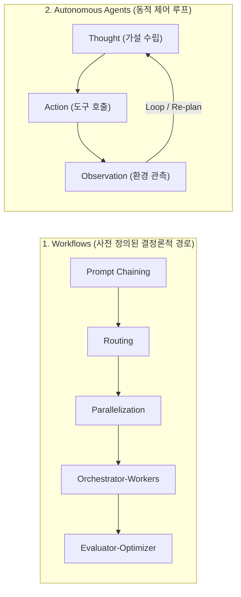
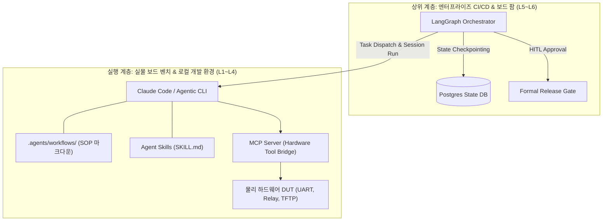

AI 코딩 에이전트를 Android Platform, Linux Kernel, 임베디드 펌웨어 등 저수준 시스템 엔지니어링에 도입할 때 가장 먼저 마주치는 아키텍처 질문은 **"에이전트의 사고와 도구 실행 흐름을 어떤 프레임워크로 통제할 것인가?"**입니다.

웹 앱이나 일반 비즈니스 로직과 달리, BSP(Board Support Package) 엔지니어링은 **수천만 줄의 코드베이스(AOSP), 수십 분에 달하는 빌드 시간, 그리고 잘못된 쓰기 작업 한 번에 보드가 영구 소손(Hard Brick)될 수 있는 물리적 위험**을 안고 있습니다. 이런 환경에서 단일 LLM에게 모든 판단을 맡기는 '만능 자율 에이전트(Do-everything Agent)'는 반드시 길을 잃거나 환각을 일으킵니다.

현재 AI 에이전트 생태계에는 이 오케스트레이션 문제를 해결하기 위한 두 가지 강력한 패러다임이 존재합니다:
1. **Anthropic의 경량 워크플로우 & 스킬 철학 (Claude Code Workflows & MCP)**
2. **LangChain의 상태 머신 그래프 패러다임 (LangGraph)**

본 글은 시리즈의 도입부(0편)로서 두 아키텍처의 이론적 배경, 실제 오픈소스 BSP 프로젝트의 시행착오와 피벗(Pivot) 교훈, 그리고 하드웨어 시스템 개발에 최적화된 오케스트레이션 전략을 심층 비교 분석합니다.

---

## 1. Anthropic의 철학: 워크플로우(Workflows) vs 자율 에이전트(Agents)

2024년 12월 Anthropic이 발표한 기념비적 가이드인 **"Building Effective Agents"**는 복잡한 프레임워크의 과대광고를 걷어내고, 에이전트 시스템을 두 가지 근본적 범주로 명확히 정의했습니다:



### 1.1 워크플로우(Workflows): 결정론적 코드 경로
* **정의**: LLM과 도구가 **사전에 프로그래밍된 코드 경로와 조건문**을 통해 조율되는 시스템입니다.
* **특징**: 예측 가능성이 높고, 디버깅이 쉬우며, 단위 테스트(Unit Test)로 동작을 100% 검증할 수 있습니다.
* **5대 핵심 패턴**:
  1. **Prompt Chaining**: 이전 단계의 출력이 다음 단계의 입력이 되는 순차 파이프라인.
  2. **Routing**: 입력을 분류하여 적절한 전문 프롬프트나 도구로 분기.
  3. **Parallelization**: 독립적인 서브태스크를 병렬 수행하거나 다수 투표(Voting)로 집계.
  4. **Orchestrator-Workers**: 중앙 LLM이 작업을 분해하고 워커들에게 위임한 뒤 종합.
  5. **Evaluator-Optimizer**: 생성자(Generator)와 평가자(Evaluator)가 피드백 루프를 돌며 품질을 개선.

### 1.2 자율 에이전트(Agents): 동적 자율 루프
* **정의**: LLM이 작업 수행 과정에서 **스스로 다음 행동과 도구 사용 여부를 결정**하며 환경과 상호작용하는 시스템입니다.
* **특징**: 예상치 못한 변수가 많은 오픈엔드 문제(예: 대규모 저장소 내 버그 탐색)에 적합하지만, 무한 루프, 컨텍스트 드리프트(Context Drift), 비결정론적 실패 위험이 수반됩니다.

> [!IMPORTANT]
> **Anthropic의 황금률 (Rule of Thumb)**:  
> *"항상 가장 단순한 솔루션(단일 프롬프트 또는 단순 체이닝)부터 시작하라. 추가적인 자율성이 가져오는 이점이 지연 시간(Latency)과 비용, 복잡성의 대가를 상회할 때만 워크플로우로, 그리고 최종적으로 자율 에이전트로 확장하라."*

---

## 2. Claude Code 중심의 실전 워크플로우 아키텍처

Anthropic의 철학을 터미널 개발 환경에 구현한 **Claude Code** 생태계는 복잡한 파이썬 오케스트레이션 프레임워크를 걷어내고, **"엔지니어가 읽을 수 있는 문서와 표준 프로토콜"**을 기반으로 에이전트를 제어합니다.

### 2.1 SOP 기반 워크플로우 (`.agents/workflows/`)
[`solitontech/arm-embedded-linux-lab`](https://github.com/solitontech/arm-embedded-linux-lab)은 실제 물리 ARM 보드(Raspberry Pi, STM32MP1 등) 벤치 랩을 구축하면서 `.agents/workflows/` 디렉터리에 표준 운용 절차(SOP)를 마크다운 파일로 정형화했습니다:

* **SOP 구조**:
  - `When to Use`: 에이전트가 이 절차를 트리거해야 하는 명확한 조건.
  - `Prerequisites`: 사전에 충족되어야 하는 보드 프로필, 도커 상태, SD 카드 마운트 조건.
  - `Steps`: `Fetch Firmware` → `Configure Boot Parameters` → `Build and Deploy` 단계별 명령어.
  - `Files Touched`: 에이전트가 수정할 파일(`[MODIFY]`)과 생성할 파일(`[CREATE]`)을 엄격히 화이트리스트화하여 임의의 파일 훼손 차단.
  - `Verify`: 성공 여부를 판정하는 결정론적 검증 단계.

```markdown
# .agents/workflows/uboot_sd_deploy.md 요약
1. Fetch Firmware: make fetch-firmware BOARD=rpi4
2. Configure Boot: configs/<board>/config.txt 및 boot.cmd 수정
3. Build & Deploy: mkimage로 boot.cmd -> boot.scr 컴파일 후 SD 카드 배포
4. Verify: 터미널 출력에서 u-boot.bin 및 boot.scr 복사 확인
```

### 2.2 점진적 노출(Progressive Disclosure) 스킬 (`SKILL.md`)
Anthropic의 공식 [`skill-creator`](https://github.com/gitcomit8/agent-skills/tree/main/skill-creator) 표준에 따라 토큰을 최적화합니다:
* **Level 1 (Metadata)**: 상시 컨텍스트에는 `name`과 `description`만 유지 (~100 토큰).
* **Level 2 (Instructions)**: 스킬이 호출되었을 때만 `SKILL.md` 본문 로드.
* **Level 3 (Resources)**: 필요한 순간에만 `scripts/`, `references/`를 선별 호출.

### 2.3 Model Context Protocol (MCP) 하드웨어 브리지
Claude Code는 독자적인 플러그인 대신 오픈 표준인 **MCP(Model Context Protocol)**를 통해 외부 도구와 통신합니다. `arm-embedded-linux-lab`의 `tools/mcp/server.py`는 FastMCP를 사용하여 물리 하드웨어를 에이전트의 표준 도구 세트로 노출합니다:
* `lab_serial_log(board, lines, pattern)` / `lab_serial_send(board, text)`
* `lab_boot_analyze(board)`: 커널 패닉 및 부팅 단계 기계적 분석
* `lab_reboot(board, method)`: 스마트 플러그 전원 릴레이 / SysRq 리셋
* `lab_bench_verify(board)`: 빌드 후 재부팅 및 시리얼 로그 사후 검증

### 2.4 경량 서브에이전트와 블랙보드 패턴 (Sub-agent & Blackboard)
[`liangyongqin/ai-bsp-knowledge-skill-sets`](https://github.com/liangyongqin/ai-bsp-knowledge-skill-sets)의 개발 로드맵에는 다음과 같은 핵심 결정이 기록되어 있습니다:
> *"Claude Code sub-agents instead of LangGraph: Skills are Claude Code native; sub-agent pattern achieves Blackboard coordination without an external framework dependency."*

외부 프레임워크 없이, Claude Code의 네이티브 서브에이전트들이 파일시스템(공유 마크다운, SQLite, Kuzu 그래프 DB)을 **블랙보드(Blackboard)** 삼아 정보를 교환하는 방식으로 오버헤드를 극소화했습니다.

---

## 3. LangGraph: 상태 머신 기반 에이전트 오케스트레이션

**LangGraph**는 복잡한 다중 에이전트 시스템과 분기 의사결정을 **순환 가능한 상태 머신(Cyclic State Machine)**으로 모델링하는 강력한 파이썬 프레임워크입니다.

```mermaid
flowchart TD
    START(["__start__"]) --> RouterNode["Router Node (의사결정)"]
    RouterNode -->|Compile Error| BuildWorker["Build Fixer Node"]
    RouterNode -->|Hardware Panic| DiagnosticWorker["Oops Analyzer Node"]
    BuildWorker --> EvaluatorNode["Evaluator Node (재빌드 검증)"]
    DiagnosticWorker --> EvaluatorNode
    EvaluatorNode -->|FAIL (재시도)| RouterNode
    EvaluatorNode -->|PASS| GateNode{"Human Approval Gate"}
    GateNode -->|Approved| DeployNode["Flash & Boot Node"]
    GateNode -->|Rejected| AbortNode(["__end__ (중단)"])
    DeployNode --> END(["__end__"])
```

### 3.1 LangGraph의 3대 핵심 구성요소
1. **State (전역 상태)**: 모든 노드가 공유하는 엄격하게 타입화된 스키마(`TypedDict` 또는 Pydantic). 에이전트의 대화 이력, 추출된 레지스터 값, 빌드 로그 등이 불변(Immutable) 상태 전이를 통해 관리됩니다.
2. **Nodes (연산 단위)**: LLM 호출 또는 파이썬 함수. 현재 State를 입력받아 새로운 State 업데이트를 반환합니다.
3. **Edges (전이 규칙)**:
   - *Normal Edge*: 고정된 다음 노드로 진행.
   - *Conditional Edge*: LLM의 판단이나 스크립트 실행 결과에 따라 다음 노드를 동적으로 라우팅.

### 3.2 LangGraph만의 강력한 차별점
* **순환 그래프(Cyclic Graphs)의 안전한 제어**:
  - `Evaluator-Optimizer` 패턴이나 에이전트 루프를 구현할 때 필수적인 루프백을 네이티브 지원하며, `recursion_limit`을 통해 무한 루프를 방지합니다.
* **시간 여행과 지속성 (Persistence & Time-Travel)**:
  - `SqliteSaver`, `AsyncSqliteSaver`, PostgreSQL 기반의 Checkpointer가 매 슈퍼스텝(Super-step)마다 상태 스냅샷을 저장합니다.
  - 장애 발생 시 특정 시점으로 상태를 되돌려 다른 가설을 시도(Time-Travel Replay)할 수 있습니다.
* **일급 시민 인간 개입 승인 (Human-in-the-Loop)**:
  - `interrupt_before=["deploy_node"]` 설정을 통해, 보드 플래싱이나 eFuse 쓰기 직전에 그래프 실행을 일시 중단하고 엔지니어의 승인 입력(`Command(resume=...)`)을 안전하게 대기할 수 있습니다.

---

## 4. 실전 저장소의 뼈아픈 교훈: LangGraph에서 Agent Skills로의 피벗

오픈소스 BSP 저장소를 분석하면서 발견한 가장 극적인 사례는 [`liangyongqin/ai-bsp-agent`](https://github.com/liangyongqin/ai-bsp-agent)의 **아키텍처 대전환(Pivot)**입니다. 이 프로젝트는 당초 야심 찬 LangGraph 기반 멀티 에이전트 팩토리로 시작했으나, 실전 운영 과정에서 심각한 한계에 부딪혀 패러다임을 전면 전환했습니다.

### 4.1 초기 아키텍처: LangGraph Meta-Agent Factory
`ai-bsp-agent`의 초기 설계는 화려했습니다:
* **Orchestrator**: LangGraph 기반 슈퍼그래프
* **Product Owner Node**: 요구사항 분석 및 스프린트 계획
* **Architect Node**: 청사진 수립 및 인터페이스 정의
* **Engineer Node (Jules)**: 격리된 Docker 컨테이너에서 코드 작성 및 Git PR 생성
* **QA Verifier Node**: 가상 샌드박스에서 빌드 및 테스트 수행

### 4.2 실제 마주친 치명적 문제점 (`issues.md` 분석)
프로젝트의 `history/issues.md`와 `history/PIVOT_PLAN.md`에 기록된 실제 실패 원인들은 에이전틱 엔지니어링의 현실을 적나라하게 보여줍니다:

1. **폴링 지연과 재귀 한도 소진 (Recursion Limit Exhaustion)**:
   - 외부 비동기 작업(PR 생성 등)을 기다리는 동안 `route_watch_tower` 노드가 600초 간격으로 폴링 루프를 돌았습니다.
   - 조건이 충족되지 않으면 LangGraph의 기본 재귀 제한(100회)에 걸려 프로세스가 강제 종료되었으며, 이 과정에서 무려 16시간(600s × 100)이 낭비되었습니다.
2. **체크포인터 오염과 상태 불일치 (Stale Checkpoint Corruption)**:
   - 고정된 `thread_id = "studio-session-v1"`을 사용하면서, 이전 실행의 실패 상태가 SQLite 체크포인터에 누적되었습니다.
   - 새 테스트를 실행할 때 이전 스프린트의 오염된 상태가 복원되어 기괴한 회귀 버그를 유발했습니다.
3. **인프라 오버헤드가 도메인 가치를 압도**:
   - 4개 에이전트 간의 Git 브랜치 동기화, Docker 볼륨 마운트 충돌, 네임스페이스 격리 관리에 투입되는 노력이 실제 커널/BSP 디버깅 가치보다 훨씬 커졌습니다.

### 4.3 피벗(Pivot)의 결론: "Anthropic Agent Skill 패러다임으로의 전환"
`PIVOT_PLAN.md`에서 저자는 다음과 같이 선언하며 아키텍처를 전면 재구축했습니다:

> *"우리는 '자동 코드 생성 공장(Automated Code-Gen Factory)' 패러다임을 포기한다. 인프라 오버헤드가 도메인 가치를 넘어섰기 때문이다. 우리는 **Anthropic Tool-Use / Agent Skill 패러다임**을 채택한다.*  
> *AI에게 코드를 직접 쓰라고 요구하는 대신, 고수준 추론 LLM에게 인간이 작성한 **결정론적 순수 파이썬 도구(`tools/bsp_diagnostics/`)**를 장착하여 로그를 파싱하고 커널/하드웨어 장애를 진단하도록 전환한다."*

그 결과, 복잡한 서브그래프들을 모두 동결(Frozen)하고, **입출력이 엄격한 Pydantic 스키마와 순수 파이썬 파서, 그리고 점진적 노출 마크다운 스킬**의 단순하고 단단한 구조로 회귀하여 성공을 거두었습니다.

---

## 5. 체계적 비교: Claude Workflow vs LangGraph

두 프레임워크의 특성을 임베디드 및 Android BSP 엔지니어링 관점에서 대조하면 다음과 같습니다:

| 비교 항목 | Claude Code Workflow + MCP | LangGraph (StateGraph) |
|---|---|---|
| **설계 철학** | **문서(SOP)와 도구 중심**<br/>(Markdown, FastMCP, Shell 직접 연동) | **상태 머신과 그래프 중심**<br/>(StateGraph, Nodes, Edges, Python 코드) |
| **상태 관리 방식** | **파일시스템 & 블랙보드**<br/>(`.agent-state/`, Git, 로컬 로그, SQLite) | **인메모리 전역 상태 & 체크포인터**<br/>(`TypedDict`, SQLite/Postgres DB) |
| **추론 통제 방식** | 마크다운 SOP 단계 및 프롬프트 규약 준수 | 노드 간 프로그래밍된 조건부 엣지(`conditional_edges`) |
| **실행 환경** | 개발자 터미널(CLI) 및 로컬 셸 직접 상호작용 | 파이썬 애플리케이션 런타임 및 백엔드 서버 |
| **하드웨어 벤치 제어** | **매우 우수**: FastMCP를 통해 시리얼, 전원, 부팅 로그를 직관적으로 제어 | 보통: 노드 내에서 파이썬 서브프로세스/시리얼 라이브러리 래핑 필요 |
| **장애 복구 및 지속성** | 로그 파일 기반 사후 분석, Git 리셋 | **매우 우수**: Checkpointer를 통한 정밀한 타임머신 롤백 |
| **승인 게이트 (HITL)** | 터미널 대화형 프롬프트 또는 사전 스크립트 잠금 | **우수**: 프레임워크 레벨의 `interrupt_before/after` 제공 |
| **복잡도 및 러닝커브** | 낮음 (표준 마크다운 작성 및 Python 함수 정의) | 높음 (상태 그래프 모델링, 리듀서 함수, 체크포인트 관리) |
| **BSP 적합 영역** | **L1~L4 레벨**: 일상적 개발자 워크플로,<br/>보드 온보딩, U-Boot/커널 빌드 & 벤치 디버깅 | **L5~L6 레벨**: 분산 보드 팜 오케스트레이션,<br/>다중 에이전트 교차 검증, 복잡한 CI/CD 트리 |

---

## 6. Android BSP를 위한 하이브리드 아키텍처 권고안

결론적으로, BSP 엔지니어링에서 **"Claude Workflow와 LangGraph 중 하나만 골라야 하는가?"**에 대한 답은 **"아니다(No)"**입니다. 두 패러다임은 상호 배타적이지 않으며, 시스템의 계층에 따라 최적의 역할이 명확히 나뉩니다:



### 6.1 실행 계층(Execution Plane): Claude Code Workflow + FastMCP (L1~L4)
* **적용 대상**: 개발자 개인 워크스테이션, 실물 보드 벤치 셋업, 일상적인 빌드 에러 수정, Device Tree 포팅.
* **권장 이유**: 복잡한 파이썬 그래프 프레임워크 없이도, 엔지니어가 읽을 수 있는 마크다운 SOP(`.agents/workflows/`)와 가벼운 MCP 도구만으로 물리 하드웨어를 안전하고 민첩하게 다룰 수 있습니다.

### 6.2 오케스트레이션 계층(Control Plane): LangGraph State Machine (L5~L6)
* **적용 대상**: 수십 대의 보드가 물려 있는 원격 보드 팜(Board Farm), 야간 회귀 테스트(Nightly Regression), Gerrit Presubmit 검증 파이프라인.
* **권장 이유**: 장시간 실행되는 비동기 작업의 중단·재개, 실패 시 이전 체크포인트로의 롤백, 그리고 엄격한 상태 전이와 다중 에이전트 간의 역할 분담(Orchestrator-Workers)이 필수적이기 때문입니다.

---

## 7. 앞으로 이어질 내용

오케스트레이션 프레임워크의 본질을 이해했다면, 이제 실제 Android 및 임베디드 BSP 생태계가 이 기술을 어떻게 수용하고 있는지 살펴볼 차례입니다:

- **[제1편: Android BSP의 Agentic Shift 정의와 생태계 흐름]({{ '/posts/agentic-bsp-shift-definition-and-landscape/' | relative_url }})**: L1~L6 성숙도 모델, 글로벌 11개 실리콘 벤더 지형도, 12대 오픈소스 저장소 분석, 그리고 무환각 5계층 스킬 구조
- **[제2편: AI-Native BSP 아키텍처의 5대 기둥]({{ '/posts/agentic-bsp-shift-five-pillars/' | relative_url }})**: Target Profile, Focused Skills, Observability 가상화, Deterministic Verifier, State Outside Conversation
- **[제3편: 단계별 전환 전략 (Phase 1: L1에서 L3~L4로 도약하기)]({{ '/posts/agentic-bsp-shift-phase1-strategy/' | relative_url }})**: 호스트 빌드 & 정적 진단의 자율 폐루프 구축
- **[제4편: Phase 2: L4에서 L5로 (Virtual DUT & 런타임 관측성)]({{ '/posts/agentic-bsp-shift-phase2-strategy/' | relative_url }})**: Cuttlefish/QEMU 가상 장치 부팅 및 Perfetto SQL 질의
- **[제5편: Phase 3: L5에서 L6로 (Physical DUT 보드 팜과 다중 에이전트 협업 체계)]({{ '/posts/agentic-bsp-shift-phase3-strategy/' | relative_url }})**: 실물 보드 팜, 하드웨어 루프, 정량적 ROI/KPI 측정 체계
