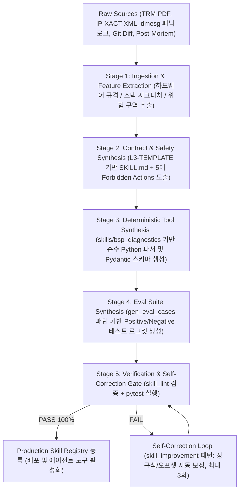

Android와 Linux Kernel, 실리콘 벤더(SoC)의 하드웨어를 함께 다루는 **BSP(Board Support Package) 엔지니어링**에도 AI를 개발 절차에 연결하려는 공개 사례가 나타나고 있습니다. 다만 단순 코드 생성 보조부터 빌드·장치 검증 자동화까지 범위가 천차만별이어서, 이를 하나의 성숙도 점수로 단정하기는 어렵습니다.

관심의 초점은 단순 코드 자동완성에서 저장소를 조사하고, 도구를 실행하며, 결과를 검증하는 **Agentic Engineering**으로 급격히 넓어지고 있습니다. 특히 BSP에서는 실제 물리 하드웨어와 수십 분에서 수 시간에 달하는 긴 빌드 절차를 연결해야 하므로, 이 전환이 어디까지 진행됐는지 공개된 근거와 실전 아키텍처를 구분해 살펴보아야 합니다.

시리즈의 첫 번째 글에서는 다음 내용을 종합적으로 정리합니다:
1. **Agentic Shift를 설명하는 분석 틀(L1~L6)**과 임베디드 BSP 환경의 물리적 특수성
2. **글로벌 실리콘 벤더(11개 사)의 에이전틱 준비 상황 및 3대 그룹 분류**
3. **오픈소스 생태계에서 수집·분석한 10대 BSP Skill 저장소의 아키텍처 특징**
4. **결정론적 무환각(Zero-Hallucination)을 보장하는 5계층 BSP Skill 표준 구조**
5. **TRM 데이터시트와 로그로부터 스킬을 자동 합성하는 'Skill Creator' 파이프라인 설계**

---

## 1. Agentic Shift의 정의: L1에서 L6까지

아래 L1~L6은 이 글에서 변화의 범위를 설명하기 위해 사용하는 **분석 틀**입니다. 업계 공통 표준이나 특정 기업의 공식 평가 결과가 아니며, 단계도 항상 순서대로 올라가는 단일 점수는 아닙니다. 예를 들어 자동 빌드 능력과 사람 승인 체계는 별도로 성숙할 수 있습니다.

| 단계 (Level) | 명칭 | 동작 방식 및 특징 | 사람의 역할 |
|---|---|---|---|
| **L1** | **Code Assist & Q&A** | 코드 라인 자동완성, 문법 질의응답, 에러 메시지 단순 해석 | 코드를 직접 작성하며 보조적 타이핑 도움을 받음 |
| **L2** | **Function & Patch Generation** | 단일 함수 작성, 단위 테스트 생성, 간단한 패치 생성 | 생성된 코드 조각을 수동으로 복사·붙여넣기 및 검증 |
| **L3** | **Repository Awareness** | 다중 파일 및 전체 저장소 구조를 파악하고 심볼/참조 기반 수정 | 작업 범위(Scope)를 지정하고 diff를 검토 |
| **L4** | **Closed-Loop Execution** | **Build → Deploy → Test → Log Analysis → Self-Correction** 루프 수행 | 시작 조건과 완료 기준을 설정하고 실행 관찰 |
| **L5** | **Workflow & CI/Gerrit Integration** | 조직의 워크플로를 스킬화(Skill)하고 코드 리뷰(Gerrit) 및 Presubmit 연계 | 아키텍처 가이드라인 수립 및 예외 상황 개입 |
| **L6** | **Orchestrated Autonomous Engineering** | 다중 에이전트가 서브시스템별로 업무를 분담하고 E2E 자율 협업 | 최종 승인(Human Approval) 및 거버넌스 감독 |

이 구분에서 중요한 것은 이름보다 **실행 권한과 검증 책임**입니다. 단순히 LLM에게 도구(Tool)를 쥐어준다고 곧바로 자율 엔지니어링이 되는 것은 아닙니다. 작업 범위(Scope), 관측 근거(Evidence), 재시도 방법(Recovery), 완료 판정(Verifier)과 사람의 승인 지점(Approval Gate)을 함께 설계해야 합니다.

일반 소프트웨어 개발에서 IDE 자동완성과 챗봇 활용이 확산되고 있지만, 보안·라이선스 정책이 엄격한 BSP 현장에서는 도구 사용 가능 여부와 현재 수준이 조직마다 다릅니다. 이 글에서는 코드 보조를 출발점으로 삼아 **L3(저장소/하드웨어 맥락 파악)와 L4(빌드-진단-수정의 검증된 폐루프)**로 나아가는 설계 방법을 다룹니다.

---

## 2. BSP에서 에이전트에 추가 설계가 필요한 이유

BSP 업무는 다음과 같은 **물리적·환경적 조건**을 포함하므로 에이전트가 사용할 수 있는 절차와 검증 기준을 구체적으로 설계해야 합니다.

### 2.1 물리적 장치(DUT)와 칩셋 의존성
- 소프트웨어뿐 아니라 SoC 리비전, PMIC 전원 시퀀싱, 클럭 트리, 핀믹스(Pinmux), DDR 트레이닝, 플래시 메모리 파티션 등 **물리적 환경의 상태**가 동작을 결정합니다.
- AI가 하드웨어 스펙을 모른 채 코드를 수정하면, 컴파일은 통과하더라도 보드가 켜지지 않거나 영구 소손(Hard Brick)될 위험이 있습니다.

### 2.2 초거대 코드베이스와 긴 빌드 시간
- AOSP의 다중 저장소 구성(5,000만 LOC 이상), 리눅스 커널(3,000만 LOC 이상), 커널의 Kleaf Bazel, Android의 Soong, Yocto의 BitBake처럼 빌드 절차는 프로젝트에 따라 다릅니다.
- 빌드 시간이 긴 환경에서 검증 없이 변경과 재빌드를 반복하면 시간과 컴퓨팅 자원이 심각하게 낭비됩니다. 에이전트는 먼저 실제 build entrypoint와 변경 범위를 확인하고, 단계별로 검증해야 합니다.

### 2.3 로그는 다 비정형이 아니다
- `printk`/`dmesg` 메시지는 사람이 읽기 쉬운 텍스트가 중심입니다. [util-linux의 `dmesg`](https://github.com/util-linux/util-linux/blob/master/sys-utils/dmesg.c)는 JSON 출력을 지원하지만 버전과 대상 이미지에서 사용 가능한지 확인해야 합니다.
- 커널 trace event는 이름과 타입이 있는 필드를 제공할 수 있습니다. Linux 커널 [Event Tracing 문서](https://docs.kernel.org/trace/events.html)에 따르면 각 event의 `format` 파일은 기록된 필드를 설명하고 binary trace를 해석하는 데 사용됩니다.
- Android와 Linux의 [Perfetto Trace Processor](https://perfetto.dev/docs/analysis/trace-processor)는 trace를 테이블과 SQL 질의로 다룹니다. [AI 분석 가이드](https://perfetto.dev/docs/getting-started/using-ai)와 에이전트 환경에서 결과 크기를 제한하고 오류를 JSON으로 내보내는 [CLI agent mode](https://perfetto.dev/docs/reference/trace-processor-cli)도 공개됐습니다.
- UART 텍스트는 보드별로 다르고, 로그 버퍼는 용량이 제한됩니다. 계측을 추가할 때는 손실·오버헤드·타이밍 영향을 함께 측정해야 합니다.

따라서 관측성 개선은 모든 로그를 새 형식으로 바꾸는 일부터 시작할 필요가 없습니다. [원본 printk 로그](https://www.kernel.org/doc/html/latest/core-api/printk-basics.html)를 보존하면서 **구조화된 trace와 프로젝트별 메타데이터를 연결하고, 에이전트가 필요한 구간을 질의하는 경로**를 만드는 것이 현실적인 출발점입니다.

---

## 3. 글로벌 실리콘 벤더와 주요 기업들의 AI Shift 지형도

공개 자료는 각 조직의 내부 AI 활용도를 보여주는 완전한 지표가 아닙니다. 외부로 공개된 오픈소스 저장소, 개발자 문서, RFC 제안에서 **직접 검증 가능한 작업 흐름(Verifiable Workflow)**을 바탕으로 글로벌 벤더들의 현주소와 준비 상황을 입체적으로 분석합니다.

> [!NOTE]
> **공개 수준과 내부 역량의 분리 (NDA Boundary)**
> 공개 Agent Skill의 부재가 해당 기업 내부에서 AI를 쓰지 않는다는 의미는 결코 아닙니다. 반도체 벤더 특성상 고객사 전용 BSP, 독점 펌웨어, 내부 검증 인프라는 엄격한 기밀유지협약(NDA)에 묶여 있기 때문입니다. 따라서 아래의 분석은 외부 엔지니어가 직접 재현하고 참조할 수 있는 **'공개 엔지니어링 에이전트 성숙도'**를 기준으로 합니다.

### 3.1 실리콘 벤더의 Agentic 성숙도 3대 그룹 분류 및 비교 매트릭스

글로벌 실리콘 벤더와 임베디드 플랫폼 기업들은 AI를 다루는 방식과 공개 수준에 따라 크게 3개 그룹으로 나뉩니다:

| 벤더 / 생태계 | 대표 HW / SW 스택 | 공식 Agent Skill 및 AI 엔지니어링 리포지토리 | 공개 성숙도 추정 | 핵심 아키텍처 및 주력 방향 |
|---|---|---|:---:|---|
| **Google** | AOSP, AndroidX,<br/>Linux Kernel, Perfetto | • [AndroidX Agent Skills](https://android.googlesource.com/platform/frameworks/support/+/f91db2f7ac997fe61637d7e1446afe2e8c110103/.agents/) (`AGENTS.md`)<br/>• [Perfetto RFC-0025](https://github.com/google/perfetto/discussions/5763) & CLI Agent Mode | **L5** | 엄격한 Worktree 격리, 단위 테스트 훈육, Trace Processor 기반 SQL 대용량 트레이스 질의 |
| **NVIDIA** | Jetson (Orin/Thor),<br/>Jetson Linux (L4T) | • [NVIDIA-AI-IOT/jetson-bsp-skills](https://github.com/NVIDIA-AI-IOT/jetson-bsp-skills)<br/>• [NVIDIA-AI-IOT/jetson-device-skills](https://github.com/NVIDIA-AI-IOT/jetson-device-skills)<br/>• [NVIDIA/skills](https://github.com/NVIDIA/skills) | **L4 ~ L5** | 호스트(BSP 커스터마이징 수명주기)와 타깃(진단/메모리 튜닝) 스킬 분리, Target Profile 기반 다단계 프로모션 |
| **Qualcomm** | Snapdragon, Qualcomm Linux,<br/>QRB/QCS IoT 플랫폼 | • [qualcomm-linux/qcom-linux-skills](https://github.com/qualcomm-linux/qcom-linux-skills) | **L3 ~ L4** | 작고 명확한 Non-destructive BSP 단위 스킬(기기 정보, QDL 저수준 플래시, 부팅 검증, 커널 백포트, LAVA CI) |
| **Intel** | Core Ultra, Xeon, Arc GPU,<br/>x86 Linux Kernel | • [intel/linux-kernel-oops](https://github.com/intel/linux-kernel-oops)<br/>• [intel/intel-performance-skills](https://github.com/intel/intel-performance-skills)<br/>• [intel/gpu-ai-skills](https://github.com/intel/gpu-ai-skills) | **L3 ~ L4** | Kernel Panic/Oops 심볼 역추적(First Bad Frame), `perf` 기반 코어 스케일링, `unitrace` 저수준 GPU 프로파일링 |
| **NXP** | i.MX 8 / 9 시리즈,<br/>meta-imx Yocto | • [nxp-imx](https://github.com/nxp-imx) 생태계<br/>• [yocto-agent-skills](https://github.com/Higangssh/yocto-agent-skills) (공동 생태계) | **L3** | Yocto 릴리즈 인지 라우팅(`yocto-doc-router`), BitBake 실패 자동 파싱(`bitbake-debug`), BSP 레이어 검증 |
| **Texas Instruments** | Sitara AM62x/AM68x,<br/>Processor SDK Linux | • [TexasInstruments/edgeai-studio-agent](https://github.com/TexasInstruments/edgeai-studio-agent)<br/>• [TexasInstruments/edgeai](https://github.com/TexasInstruments/edgeai) | **L2 ~ L3** | 타깃 보드 연동 디바이스 에이전트, 컨테이너 기반(GHCR Docker) 재현 가능한 OpenEmbedded 빌드 |
| **MediaTek** | Dimensity, Genio IoT,<br/>NeuroPilot, AOSP | • [MediaTek 공식 GitHub](https://github.com/mediatek)<br/>• Genio Developer Platform | **L2 ~ L3** | 온디바이스 NPU 역량은 강력하나 공개 BSP 스킬은 제한적. 견고한 AOSP/Yocto CLI 스크립트 기반 보유 |
| **Renesas** | R-Car, RZ 시리즈,<br/>e2 studio | • [renesas/renesas-skills](https://github.com/renesas/renesas-skills) | **L2 ~ L3** | `npx skills` 배포 체계, `.vscode/launch.json` 디버거 설정 자동화(`configure-renesas-debug`), RTOS 디버깅 |
| **STMicroelectronics** | STM32MP1/MP2 (MPU),<br/>OpenSTLinux | • [STM32 Sidekick](https://www.st.com/content/st_com/en/about/ai-at-st/stm32-sidekick.html)<br/>• STM32CubeAI | **L1 ~ L2** | 방대한 데이터시트/레퍼런스 매뉴얼 기반 Grounded RAG AI Assistant, 엣지 AI 모델 배포 툴체인 |
| **Rockchip** | RK3588/RK3568,<br/>Rockchip Linux BSP | • [rockchip-linux](https://github.com/rockchip-linux)<br/>• `rkbin`, `rkdeveloptool` | **L1 ~ L2** | 전통적 Git/tarball 및 독점 바이너리(`rkbin`) 중심. 소스 분석과 바이너리 출처 검증 분리 실험의 최적 플랫폼 |
| **Android Kernel / AOSP** | Android GKI (6.1/6.6/6.12),<br/>AOSP Low-Level, Vendor Modules | • [jonaschen/Android-Software](https://github.com/jonaschen/Android-Software)<br/>• [tzussman/kernel-dev-skill](https://github.com/tzussman/kernel-dev-skill)<br/>• [gitcomit8/agent-skills](https://github.com/gitcomit8/agent-skills) | **L3 ~ L4** | GKI KMI ABI 심볼 검증(`L2-kernel-gki-expert`), 칩셋별 브링업(`L3-qualcomm-kernel`, `L3-mediatek-kernel`), 부트로더(LK), ATF 및 업스트림 커널 패치 워크플로 스킬 |
| **Arm / Linaro** | Cortex-A/M, Arm Virtual Hardware,<br/>LAVA Test Lab | • [ARM-software/AVH](https://github.com/ARM-software/AVH)<br/>• Linaro LAVA Lab Automation | **L4 ~ L5 (인프라)** | 실리콘 없는 가상 플랫폼(FVP) 기반 CI/CD 파이프라인, 보드 팜 원격 제어 및 테스트 자동화 표준 |

---

### 3.2 Group A (선도 벤더): 호스트와 디바이스의 체계적 분리

#### 1. Google: 저장소 훈육(Discipline)과 Trace Processor SQL 인터페이스
- **저장소 수준의 에이전트 통제 ([AndroidX Agent Skills](https://android.googlesource.com/platform/frameworks/support/+/f91db2f7ac997fe61637d7e1446afe2e8c110103/.agents/))**:
  - Google AndroidX 팀은 에이전트가 코드를 건드리기 전에 반드시 Git Worktree를 생성하여 메인 작업공간을 보호하도록 강제합니다.
  - 에이전트가 패치를 작성한 뒤에는 반드시 로컬 단위 테스트를 실행하여 회귀(Regression)가 없음을 검증하고, 검증된 사실(Fact)만을 커밋 메시지에 명시하도록 하는 **엄격한 저장소 훈육 규칙(`AGENTS.md`)**을 운영합니다.
- **Trace Processor의 에이전트 모드 ([Perfetto RFC-0025](https://github.com/google/perfetto/discussions/5763))**:
  - 수백 MB에 달하는 런타임 시스템 트레이스를 모델 컨텍스트에 무작정 넣으면 토큰 한도 초과와 환각이 발생합니다.
  - Perfetto 팀은 `--agent-mode` CLI 플래그를 공식 도입하여, 에이전트가 필요한 구간(스레드 슬라이스, 바인더 지연, CPU 주파수 전이 등)만 SQL 질의로 정밀 추출하고 정형화된 JSON 결과를 받아 가설을 검증할 수 있는 표준 프로토콜을 구현했습니다.

#### 2. NVIDIA: 호스트 BSP 수명주기와 타깃 진단의 이원화
NVIDIA는 임베디드 리눅스/보드 환경에서 가장 완성도 높은 **호스트-타깃 분리형 아키텍처**를 공개하고 있습니다.
- **호스트 측 BSP 수명주기 제어 ([`NVIDIA-AI-IOT/jetson-bsp-skills`](https://github.com/NVIDIA-AI-IOT/jetson-bsp-skills))**:
  - 호스트 PC에서 실행되며, 하드웨어 형상을 선언하는 `Target Profile`을 바탕으로 명확한 다단계 파이프라인을 밟습니다:
    $$\text{Setup (타깃/아티팩트 초기화)} \longrightarrow \text{Customize (핀믹스/UPHY/PCIe/팬/카메라)} \longrightarrow \text{Build (DTS/커널)} \longrightarrow \text{Deploy/Flash} \longrightarrow \text{Validate}$$
  - 빌드 산출물의 해시와 타깃 형상을 상태 파일로 기록하여 이전 빌드의 낡은 바이너리(Stale Artifact)를 보드에 플래싱하는 사고를 원천 방지합니다.
- **타깃 측 온디바이스 진단 및 튜닝 ([`NVIDIA-AI-IOT/jetson-device-skills`](https://github.com/NVIDIA-AI-IOT/jetson-device-skills))**:
  - 부팅이 완료된 실물 젯슨 장치 위에서 직접 실행되는 전문 스킬입니다.
  - `jetson-diagnostic` (GPU, 메모리, 발열, 전력 모드, 스토리지 통합 스냅샷 캡처), `jetson-memory-audit` (DRAM 및 NvMap 메모리 누수 감사), `jetson-headless-mode` (배포 전 불필요한 데스크톱 UI 서비스 안전 제거) 등을 자율 수행합니다.
- **보안 및 서명 거버넌스 ([`NVIDIA/skills`](https://github.com/NVIDIA/skills))**:
  - 기업용 스킬 카탈로그에 `SkillSpector` 정적 보안 분석기와 `.oms.sig` 암호학적 디지털 서명을 적용하여, 검증되지 않은 악성 스크립트가 하드웨어 제어 파이프라인에 침투하는 것을 차단합니다.

#### 3. Qualcomm: 작고 명확한 Non-destructive BSP 절차
- **절차의 스킬화 ([`qualcomm-linux/qcom-linux-skills`](https://github.com/qualcomm-linux/qcom-linux-skills))**:
  - Qualcomm은 "AI에게 코드를 작성하라"고 요구하는 대신, **BSP 엔지니어의 반복적인 문제 해결 절차(Procedure)를 독립된 스킬로 모듈화**했습니다.
  - 보드 식별(`qcom-device-info`), 저수준 긴급 다운로드 플래시(`qcom-flash-qdl`), 부팅 검증(`qcom-boot-validate`), 커널 플랫폼 백포트(`qcom-kernel-platform-backport`), LAVA CI 결과 분석(`qcom-yocto-lava-ci-report`)으로 세분화됩니다.
- **비파괴 기본 원칙(Non-destructive Default)과 엄격한 종료 코드**:
  - 보드를 조작할 때 파괴적 작업(플래시, 전원 강제 차단)은 사전 승인 토큰을 요구하며, 모든 절차의 성공 여부는 모호한 텍스트 답변이 아니라 `PASS / FAIL` 및 스크립트 종료 코드(`exit 0`)로 판정합니다.

---

### 3.3 'Traditional BSP'의 역설: 덜 자동화된 환경일수록 AI ROI가 더 크다

실리콘 벤더 지형도를 분석하면서 얻을 수 있는 가장 중요한 공학적 통찰은 다음과 같습니다:

> **"이미 CI/CD가 완벽히 갖춰진 최첨단 환경(Group A)보다, 오히려 문서가 파편화되어 있고 수작업 빌드/플래시가 만연한 전통적 BSP 환경(Group C)에서 Agentic Shift의 실질적 투자 수익률(ROI)이 훨씬 더 높을 수 있다."**

```text
[ 전통적 BSP 환경의 엔지니어 수작업 병목 ]
PDF 매뉴얼 검색 ──▶ 브랜치 확인 ──▶ DTS 노드 추적 ──▶ 바이너리 펌웨어 버전 대조 ──▶ 수작업 빌드 ──▶ 수동 플래시 ──▶ 시리얼 터미널 육안 확인
               ▲                                                                                                    │
               └────────────────────── 문제 발생 시 수작업 디버깅 루프 무한 반복 ────────────────────────────────────┘
```

전통적 환경에서는 엔지니어가 순수 소스 코드 작성보다 **"맞는 브랜치 찾기, 누락된 DTS 속성 찾기, 바이너리 펌웨어 버전 충돌 해결, 플래시 툴 옵션 맞추기"**와 같은 반복적 조사와 수작업 환경 세팅(Human Touch)에 대부분의 시간을 뺏깁니다.

이 반복 과정을 `target-profile`과 `focused-skills`로 묶어 에이전트에게 위임하면, 엔지니어의 직접 투입 시간(Human Touch Time)을 극적으로 절감하는 효과를 거둘 수 있습니다. 즉, 에이전틱 전환의 가치는 벤더의 최신 기술 유무가 아니라 **"현재 우리 팀의 업무 파이프라인에서 사람이 낭비하고 있는 병목이 어디에 있는가"**에 정비례합니다.

---

## 4. 우리가 분석한 오픈소스 BSP Skill 10대 저장소의 구조적 특징

우리는 인터넷에 공개된 다양한 엔지니어링 에이전트 저장소를 로컬 환경에 직접 클론하고 심층 분석했습니다. 각 리포지토리가 취하고 있는 구조적 특징과 장단점을 비교하면 다음과 같습니다.

### 4.1 10대 오픈소스 BSP Skill 비교 매트릭스

| 저장소명 | 핵심 도메인 | 스킬 구현 방식 | 안전/거버넌스 장치 | 지식 표현 및 평가(Eval) 체계 |
|---|---|---|---|---|
| **`jonaschen/Android-Software`** | AOSP 저수준,<br/>GKI, LK, ATF, HAL | Markdown 계층 계약<br/>(L1/L2/L3 계층 라우팅) | **`Forbidden Actions` 필수화** (최소 5개),<br/>Path Scope 화이트리스트 | `skill_lint.py` 정적 검증,<br/>`references/` 마크다운 지식 |
| **`jonaschen/ai-bsp-agent`** | Android/Linux BSP<br/>RCA 진단 (v6.8) | **결정론적 Python Tools**<br/>(`skills/bsp_diagnostics/`) | 정규식 조기부팅 선별(LLM 우회),<br/>입출력 Pydantic 스키마 강제 | 539개 단위/통합 테스트,<br/>`skill_improvement.py` 자가 학습 |
| **`ai-bsp-knowledge-skill-sets`** | SoC 하드웨어 지식,<br/>DVFS, 전원, 클록 트리 | Claude Code 스킬 +<br/>임베디드 그래프 DB (Kuzu) | 원시 레지스터 주소 검증기,<br/>중복 노드 방지 멱등성 보장 | **380+ 정량 회귀 테스트(Eval)**,<br/>`hardware-spec-extractor` (TRM/XML) |
| **`qualcomm-linux/qcom-linux-skills`** | Snapdragon Linux,<br/>QDL 플래시, 부팅 검증 | 단위 Python CLI 스크립트<br/>(`pyserial` UART 자동화) | 비파괴 기본 원칙, 종료 코드(`exit 0`),<br/>Fenced Sanity Checks | `references/` 보드 메타데이터,<br/>LAVA CI 연동 리포트 |
| **`Higangssh/yocto-agent-skills`** | Yocto Project,<br/>BitBake 빌드 트리아지 | 릴리즈 인지 라우팅 +<br/>참조 문서 점진적 노출 | 버전 간 문법 오염 원천 차단,<br/>`do_compile` 에러 구간 추출 | `evals/cases/` 프롬프트 벤치마크,<br/>QA 에러 및 오버라이드 가이드 |
| **`intel/linux-kernel-oops`** | x86 Linux 커널<br/>Panic/Oops 분석 | Stack Trace 파서 +<br/>`decode_stacktrace.sh` | 디버그 심볼(`vmlinux`) 필수 요구,<br/>구조화된 RCA 템플릿 강제 | First Bad Frame 심볼 역추적,<br/>`evals/` 모의 크래시 검증 |
| **`tzussman/kernel-dev-skill`** | Linux 커널 업스트림<br/>워크플로 자동화 | 공식 CLI 도구 래퍼<br/>(`b4`, `virtme-ng`, `git-bisect`) | 가상화 마이크로VM 격리 실행,<br/>Git 워크트리 변경 격리 | Linux 커널 개발 워크플로 매핑,<br/>Mailing List 패치 검증 |
| **`gitcomit8/agent-skills`** | Linux 드라이버 개발,<br/>ftrace, kprobes | 태스크 단위 Markdown 스킬<br/>(드라이버 보일러플레이트) | 단계별 커널 체크패치(`checkpatch.pl`),<br/>코딩 컨벤션 검사 | I2C/SPI 드라이버 참조 코드,<br/>커널 디버깅 헬퍼 가이드 |
| **`NVIDIA/skills`** | Jetson / Robotics<br/>엔터프라이즈 스킬 | Agent Skills Spec 준수<br/>(Skill Cards + 서명) | **SkillSpector 보안 스캔**, 암호 서명,<br/>Capability Governance 정책 | `evaluating-agent-skills.mdx`,<br/>Skill Card 표준 메타데이터 |
| **`renesas/renesas-skills`** | Renesas R-Car / MPU<br/>VS Code IDE 연동 | `npx skills` 배포 패키지 +<br/>`launch.json` 설정기 | 하드웨어 디버거(J-Link/E2) 파라미터 유효성,<br/>GDB 명령 검증 | 벤더 하드웨어 디버거 매핑,<br/>RTOS 스레드 인지 디버깅 설정 |

---

### 4.2 10대 저장소에서 도출한 핵심 설계 특징

#### 1. "결정론적 추론 우선(Deterministic over Autonomy)" 원칙 (`ai-bsp-agent`)
LLM에게 16진수 레지스터 주소 계산, 비트마스크 시프트, 수만 줄의 dmesg 정규식 파싱을 맡기면 반드시 환각이 발생합니다. `ai-bsp-agent`는 LLM(Brain)에게 오직 고수준 가설 수립과 도구 디스패치만 맡기고, **실제 계산과 로그 추출은 100% 순수 파이썬 도구(`skills/bsp_diagnostics/`)**에 위임합니다. 특히 초기 부팅 로그(TF-A, LK, U-Boot)는 순수 정규식으로 선별하여 LLM 호출 자체를 건너뜁니다.

#### 2. MMU 스타일의 계층적 라우팅과 엄격한 경로 제약 (`Android-Software`)
5,000만 줄이 넘는 AOSP에서 전체 트리를 에이전트에게 한 번에 노출하면 문맥이 오염됩니다. `Android-Software`는 CPU의 MMU(Memory Management Unit)처럼 동작하는 **3계층 구조**를 취합니다:
* **L1 Router**: 사용자 질의를 분석하여 generic AOSP 서브시스템으로 분기
* **L2 Subsystem Expert**: `hardware/interfaces/`, `system/sepolicy/` 등 허용된 디렉터리(`path_scope`) 내에서만 탐색
* **L3 OEM/SoC Expert**: `vendor/<oem>/`, `device/<oem>/` 등 벤더 고유 디렉터리로의 오버라이드 및 이관 처리

#### 3. 하드웨어 지식의 구조화 및 규격서 자동 추출 (`ai-bsp-knowledge-skill-sets`)
단순 텍스트 매뉴얼을 벡터 DB에 임베딩하는 방식은 레지스터 비트 필드나 전원 시퀀싱 같은 정밀 하드웨어 관계를 보장하지 못합니다. 이 프로젝트는 **Kuzu 임베디드 그래프 DB**를 활용하여 레지스터, 클록 소스, 파워 도메인의 물리적 의존성을 모델링하며, **`hardware-spec-extractor`**를 통해 IP-XACT 2022 XML 및 PDF TRM에서 레지스터 맵을 자동 추출합니다.

#### 4. 파괴적 작업과 사후 검증의 엄격한 분리 (`qcom-linux-skills`)
보드를 다루는 스킬은 절대 '수정과 검증'을 한 번에 섞어 실행하지 않습니다. 플래싱을 수행하는 변이 스킬(`qcom-flash-qdl`)과 시리얼 콘솔을 열어 정상 부팅 여부를 판정하는 검증 스킬(`qcom-boot-validate`)이 명확히 분리되어 있으며, 검증 스킬은 모호한 자연어가 아닌 `exit 0` 종료 코드와 `BOOT-VALIDATION: PASS / FAIL` 펜스 태그를 반환합니다.

#### 5. 점진적 노출(Progressive Disclosure)과 스킬 린트 (`skill-creator` & `skill_lint.py`)
Anthropic의 공식 `skill-creator` 표준과 `Android-Software`의 `skill_lint.py`는 스킬 파일의 토큰 낭비를 원천 차단합니다:
* **Level 1 (Metadata)**: 프런트매터(`name`, `description`)만 상시 컨텍스트에 유지 (~100 단어)
* **Level 2 (SKILL.md 본문)**: 스킬이 트리거되었을 때만 로드 (<500 라인)
* **Level 3 (번들 리소스)**: `references/`, `scripts/`는 필요할 때만 선별 호출

---

## 5. 우리가 정의하는 실전 BSP Skill 5대 표준 구성 체계 (The 5-Part Skill Anatomy)

위 10대 저장소의 장점(Android-Software의 계층 라우팅 + ai-bsp-agent의 결정론적 파이썬 도구 + ai-bsp-knowledge의 하드웨어 지식 그래프 + Qualcomm의 비파괴 검증)을 결합하여, **프로덕션 환경을 위한 BSP Skill 표준 구조**를 확립합니다:

```text
skills/<subsystem>/<skill-name>/
├── SKILL.md                 # [1] 에이전트 계약, 라우팅 및 안전 규칙 (Markdown Contract)
├── tools/                   # [2] 결정론적 실행 파이썬 도구 (Deterministic Python Tools)
│   ├── __init__.py
│   ├── parser.py            # 로그/레지스터 파서 (Regex, Hex, Bitwise)
│   └── verifier.py          # 판정기 (Tri-Diff, KMI 심볼 대조, DTB 정적 검증)
├── schemas/                 # [3] 엄격한 입출력 스키마 (Pydantic Models)
│   └── types.py             # LLM 환각 인자 방지 및 구조화된 반환 타입
├── references/              # [4] 도메인 지식 베이스 (Memory & Hardware Spec)
│   ├── registers.yaml       # 레지스터 오프셋, 비트필드 마스크, 기본값
│   ├── power_clock_tree.md  # 전원 레일 및 클록 소스 종속성 다이어그램
│   └── post_mortems.md      # 과거 유사 장애 사례 및 해결 시그니처
└── evals/                   # [5] 지속적 정량 평가 및 회귀 테스트셋 (Continuous Evals)
    ├── cases.json           # 실제 하드웨어 실패/정상 로그 스니펫 (Ground Truth)
    └── test_skill.py        # pytest 기반 검증 자동화 스크립트
```

### 5.1 `SKILL.md` 표준 규격 (엄격한 린트 강제)
모든 `SKILL.md`는 `skill_lint.py`를 통해 다음 규칙을 100% 통과해야 배포될 수 있습니다:

1. **YAML Frontmatter 필수 6대 필드**:
   * `name`: `<layer>-<subsystem>-<domain>-expert` 형식의 고유 식별자
   * `layer`: `L1` (Root Router), `L2` (Generic Subsystem), `L3` (OEM/SoC-specific)
   * `path_scope`: 에이전트가 탐색/수정할 수 있는 파일 시스템 경로 목록 (와일드카드 남용 금지)
   * `version`: SemVer 형식 (`1.0.0`)
   * `android_version_tested`: 검증 완료된 플랫폼 환경 (예: `Android 15 / Kernel 6.6`)
   * `parent_skill`: 상위 계층 스킬명 (L3는 반드시 대응하는 L2 부모 스킬 지정)

2. **필수 7대 마크다운 섹션**:
   * `## Path Scope`: 허용 경로 및 상속 경로 명시 테이블
   * `## Trigger Conditions`: 스킬 호출 조건 및 상위 이관(Escalation) 조건
   * `## Architecture Intelligence`: 하드웨어/서브시스템 멘탈 모델 및 벤더 고유 편차
   * `## Forbidden Actions`: **최소 5개 이상의 금지 행위 강제** (예: GKI KMI 임의 수정 금지, 미인가 eFuse 쓰기 금지, permissive SELinux 남용 금지, NDA 바이너리 커밋 금지)
   * `## Tool Calls`: 제공되는 결정론적 도구 호출 예시 및 인자 설명
   * `## Handoff Rules`: 문맥 전환을 위한 `[HANDOFF → <target>]` 명시
   * `## References`: 연관 레퍼런스 문서 및 지식 파일 경로

---

## 6. BSP Skill Creator: 규격서와 로그로부터 스킬을 자동 합성하는 파이프라인

### 6.1 왜 Skill Creator가 필요한가?
SoC 벤더의 TRM은 수천 페이지에 달하고, 커널 리베이스마다 수백 개의 패치가 유입되며, 매일 수십 건의 dmesg/UART 부팅 장애 로그가 발생합니다. **이를 엔지니어가 수작업으로 스킬화하는 것은 물리적으로 불가능합니다.**

따라서 비정형 하드웨어 문서와 현장 로그를 입력받아 표준 5계층 BSP 스킬로 변환하고, 자가 치유(Self-Healing)를 거쳐 등록하는 **Skill Creator 파이프라인**이 필수적입니다:



### 6.2 5단계 합성 파이프라인 세부 동작

1. **Stage 1: Ingestion & Feature Extraction (특징 추출)**
   * `hardware-spec-extractor`를 활용하여 PDF/XML에서 레지스터 이름, 오프셋, 비트필드(RW/RO), 리셋 값을 추출합니다.
   * `ingest_postmortem.py`와 `kernel_oops` 파서를 적용하여 패닉 로그의 콜스택 시그니처와 원인 컴포넌트를 분리합니다.
   * 전원 레일(PMIC), eFuse, GKI ABI 심볼 등 위험 영역을 기계적으로 태깅합니다.

2. **Stage 2: Contract & Safety Synthesis (계약 및 안전망 합성)**
   * `L3-TEMPLATE` 규격에 맞추어 `SKILL.md`의 Frontmatter와 Path Scope를 생성합니다.
   * Stage 1에서 태깅된 위험 영역을 기반으로 **최소 5개 이상의 맞춤형 `Forbidden Actions`**를 자동 생성하여 하드웨어 파손을 방지합니다.
   * Pydantic 입출력 데이터 모델(`schemas/types.py`)을 자동 코딩합니다.

3. **Stage 3: Deterministic Tool Synthesis (결정론적 도구 작성)**
   * LLM의 추측을 배제하기 위해 `skills/bsp_diagnostics/` 패턴에 따른 순수 파이썬 파서 및 검증 스크립트(`tools/parser.py`, `tools/verifier.py`)를 생성합니다.
   * 16진수 레지스터 연산, DTB tri-diff, dmesg 정규식 추출 로직을 하드코딩합니다.

4. **Stage 4: Eval Suite Synthesis (평가셋 자동 구축)**
   * `gen_eval_cases` 패턴을 통해 실제 버그 발생 로그 기반 **Positive Test Cases**를 작성합니다.
   * 정상 부팅 로그나 무관한 드라이버 로그를 기반으로 오탐(False Positive)을 걸러내는 **Negative Test Cases**를 함께 생성합니다.

5. **Stage 5: Verification & Closed-Loop Refinement (자가 치유 검증 루프)**
   * `skill_lint.py`를 구동하여 마크다운 문서 규격과 필수 섹션을 엄격하게 검증합니다.
   * `pytest evals/`를 실행하여 생성된 파이썬 도구가 평가셋을 100% 정확하게 진단하는지 확인합니다.
   * 테스트 실패 시 `skill_improvement.py`의 자가 치유(Self-Healing) 알고리즘을 구동하여 정규식 패턴을 자동 보정하며, 모든 관문을 통과한 스킬만 프로덕션 레지스트리에 등록합니다.

---

## 7. 앞으로 이어질 내용 (시리즈 목차)

Android BSP의 Agentic 전환은 단순히 도구를 연결하는 것을 넘어, 하드웨어 지식과 안전 거버넌스를 아우르는 체계적인 엔지니어링 작업입니다. 이어지는 글들에서는 이 설계를 바탕으로 실전 환경을 단계별로 구축해 나갑니다:

- **[제2편: AI-Native BSP 아키텍처의 5대 기둥]({{ '/posts/agentic-bsp-shift-five-pillars/' | relative_url }})**: Target Profile, Focused Skills, Observability, Deterministic Verifier, State Outside Conversation
- **[제3편: 단계별 전환 전략 (Phase 1: L1에서 L3~L4로 도약하기)]({{ '/posts/agentic-bsp-shift-phase1-strategy/' | relative_url }})**: 호스트 빌드 & 정적 진단의 자율 폐루프 구축
- **[제4편: Phase 2: L4에서 L5로 (Virtual DUT & 런타임 관측성)]({{ '/posts/agentic-bsp-shift-phase2-strategy/' | relative_url }})**: Cuttlefish/QEMU 가상 장치 부팅 및 Perfetto SQL 질의
- **[제5편: Phase 3: L5에서 L6로 (Physical DUT 보드 팜과 다중 에이전트 협업 체계)]({{ '/posts/agentic-bsp-shift-phase3-strategy/' | relative_url }})**: 실물 보드 팜, 하드웨어 루프, 정량적 ROI/KPI 측정 체계

BSP 엔지니어링은 하드웨어의 동작을 소프트웨어와 검증 절차로 확인하는 일입니다. 에이전트가 신뢰할 수 있는 결정론적 도구와 엄격한 계약(Contract)을 갖출 때, 비로소 안전하고 강력한 자율 엔지니어링이 완성됩니다.
