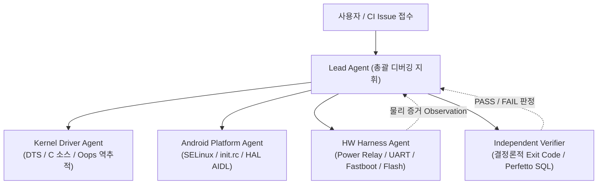

이전 편에서는 소프트웨어 가상화 장치(Virtual DUT)인 Cuttlefish/QEMU를 활용하여 호스트와 샌드박스 환경에서 런타임 버그를 잡고, Gerrit Presubmit CI 파이프라인에 검증 에이전트를 통합하는 **Phase 2(L4에서 L5로의 도약)** 전략을 살펴보았습니다.

하지만 임베디드 및 Android BSP 엔지니어링의 최종 목적지는 결코 가상 머신에 머무를 수 없습니다. 실제 실리콘 칩셋, 물리적 PMIC 전원 라인, 발열에 따른 스로틀링, 고속 인터페이스(PCIe, UFS, MIPI, USB)의 물리 계층 신호 품질(Signal Integrity), 그리고 실제 주변장치와의 물리 버스 통신은 오직 **실물 타깃 보드(Physical DUT: Device Under Test)** 위에서만 검증될 수 있기 때문입니다.

시리즈의 대미를 장식하는 이번 [제5편]에서는 에이전틱 전환의 최종 단계인 **"Phase 3: L5에서 L6로의 완성 — 실물 보드 팜(Physical DUT Farm), 하드웨어 인더루프(HIL), 다중 에이전트 협업 체계, 그리고 정량적 ROI/KPI 평가"**를 심층적으로 다룹니다.

---

## 1. 가상 DUT에서 실물 DUT로: 극복해야 할 물리적 장벽

가상 DUT(Virtual DUT)는 무한한 복제성과 빠른 스냅샷 복구라는 장점을 주지만, 실물 하드웨어와는 근본적으로 다른 다음과 같은 물리적 제약이 존재합니다.

```
                    ┌─────────────────────────────────────────┐
                    │      가상 DUT (Phase 2 / Cuttlefish)     │
                    │  - 빠른 기동, 무제한 인스턴스, 스냅샷 복구 │
                    │  - 프레임워크/HAL/SELinux 정책 사전 검증 │
                    └────────────────────┬────────────────────┘
                                         │ CI 통과 후 승격 (Promotion)
                                         ▼
                    ┌─────────────────────────────────────────┐
                    │      실물 DUT (Phase 3 / Board Farm)    │
                    │  - 실제 PMIC 전원 시퀀스 / LDO 전압 안정성 │
                    │  - 고속 버스 물리 신호 (PCIe/MIPI/UFS)  │
                    │  - 열 방출/스로틀링 & 전력 소모 계측      │
                    │  - 하드웨어 락업/Brick 위험 관리 필요   │
                    └─────────────────────────────────────────┘
```

1. **하드웨어 락업(Lockup)과 전원 사이클링의 부재**:
   - 가상 머신은 프로세스를 강제 종료(`kill`)하면 그만이지만, 실물 보드는 커널 패닉이나 버스 스톨(Bus Stall) 시 시스템이 완전히 멈춰버립니다. 에이전트가 이를 원격에서 제어하려면 소프트웨어 명령이 아닌 **물리적 스마트 파워 릴레이(Power Relay)**를 조작할 수 있어야 합니다.
2. **비대칭 I/O와 부팅 모드 제어**:
   - 디바이스가 켜질 때 Fastboot, EDL(Emergency Download), Recovery, Normal Boot 중 어떤 모드로 진입할지는 물리적 볼륨 키 콤비네이션이나 핀 점퍼, 또는 부트로더 인터럽트에 좌우됩니다.
3. **영구 손상(Brick) 및 보안 퓨즈(eFuse) 위험**:
   - 잘못 빌드된 ABL(Android Bootloader)이나 파티션 테이블(GPT)을 플래싱하면 보드가 영구적으로 벽돌(Hard Brick)이 되거나, 프로덕션 보안 키(eFuse)를 잘못 태우는 치명적 사고가 발생할 수 있습니다.

따라서 Phase 3는 단순히 에이전트에게 `adb` 터미널 권한을 더 주는 것이 아니라, **보드를 안전하게 감싸는 '엔지니어링 하네스(Engineering Harness)'와 엄격한 '비파괴 승인 거버넌스'**를 구축하는 것이 핵심입니다.

---

## 2. 실물 보드 팜(Board Farm) 제어 하네스 아키텍처

L6 단계의 자율 에이전트가 실물 보드를 조작하기 위해 조직이 갖추어야 할 물리 하네스 레이어는 다음과 같이 구성됩니다.

```text
[ Orchestrator / Lock Manager ]
       │
       ├─ Board Reservation Token 발급 (단일 점유 보장)
       │
       ▼
[ Hardware Control Harness ]
  ├── 1. 전원 제어: Smart PDU / Relay Board (Cold Boot / Power Cycle)
  ├── 2. 시리얼 수집: USB-to-UART Multiplexer (Early Bootrom / PBL / Kernel 콘솔)
  ├── 3. USB 멀티플렉서: Host PC ↔ Fastboot / ADB 연결 자동 스위칭
  └── 4. 계측 장비 연동: Monsoon / Power Monitor (전력 소모 프로파일링)
```

### 2.1 하드웨어 인더루프(HIL) 기본 4대 요소

1. **원격 전원 릴레이 제어 (Cold Reset API)**:
   - 보드가 응답 불능(Unresponsive)에 빠졌을 때, 에이전트가 `power_cycle(dut_id)` 어댑터를 호출하여 물리적으로 전원을 차단(Cut-off)하고 3초 후 재인가할 수 있어야 합니다.
2. **UART 시리얼 멀티플렉싱과 링버퍼 로거**:
   - 커널 초기 부팅 단계나 부트로더(PBL/XBL/U-Boot) 단계에서는 ADB가 동작하지 않습니다. 시리얼 콘솔 출력을 상시 캡처하고, 타임스탬프와 함께 로컬 링버퍼 파일로 스트리밍하는 백그라운드 데몬이 필수적입니다.
3. **보드 점유 잠금 및 랩 자동화 (Linaro LAVA & Token Reservation)**:
   - 물리 보드는 수량이 한정되어 있습니다. 복수의 에이전트나 엔지니어가 동일한 DUT에 동시에 이미지를 굽거나 리셋을 날리지 않도록 중앙 락 매니저를 통해 원자적(Atomic) 토큰을 발급합니다.
   - 실제 업계에서는 Linaro LAVA(Automated Validation Architecture)와 Qualcomm의 [`qcom-yocto-lava-ci-report`](https://github.com/qualcomm-linux/qcom-linux-skills)처럼, 보드 스케줄링과 플래시/부팅 검증을 통합 파이프라인으로 제어하는 방식이 표준으로 자리잡고 있습니다.
4. **EDL/Maskrom/Fastboot 비상 복구 자동화**:
   - 부팅 실패로 커널 진입이 불가할 때, 핀 제어나 USB 전원 단속을 통해 칩셋의 비상 다운로드 모드로 강제 진입시켜 클린 팩토리 이미지로 원복하는 안전망을 갖춥니다.
   - 예: Qualcomm의 EDL(Emergency Download) 프로토콜 기반 [`qcom-flash-qdl`](https://github.com/qualcomm-linux/qcom-linux-skills), Rockchip의 Maskrom 모드 및 [`rkdeveloptool`](https://github.com/rockchip-linux/rkdeveloptool), NVIDIA 젯슨의 Force Recovery 모드 제어.

---

## 3. 비파괴 승인 거버넌스 (Flash & Fuse 정책)

에이전틱 전환에서 가장 중요한 철칙은 **"에이전트에게 물리 장치를 파괴할 수 있는 전권을 주지 않는다"**는 점입니다.

| 작업 범주 | 에이전트 자율 권한 (Autonomous) | 사람 승인 필수 (Human Approval Gate) |
|---|---|---|
| **플래시 파티션** | `boot.img`, `vendor_boot.img`, `init_boot.img`, `system.img` (휘발성/복구 용이 파티션) | `xbl`, `abl`, `uefi`, `tz`, `rpm`, `gpt` (부트로더 및 파티션 테이블) |
| **장치 상태 제어** | 일반 리부트, Fastboot 진입, Cold Power Cycle, ADB root | eFuse Write, RPMB 프로비저닝, Secure Boot 키 굽기 (영구 물리 변조) |
| **코드 반영** | 격리 브랜치 커밋, Gerrit Presubmit `Verified +1` 리뷰 등록 | 메인 브랜치 `Code-Review +2`, `Submit`, 양산 브랜치 태깅 |

에이전트가 부트로더 관련 취약점을 디버깅하더라도, 플래싱 명령 단계에서는 명확한 체크섬과 diff 증거를 첨부하여 **"시니어 BSP 엔지니어의 디지털 서명 승인"**이 떨어져야만 실제 물리 디바이스의 부트로더 파티션에 접근할 수 있도록 하네스 수준에서 하드 블로킹합니다.

---

## 4. 다중 에이전트 협업 체계: 단일 Lead Agent와 전문 서브에이전트

복잡한 안드로이드 BSP의 풀스택 문제를 단일 거대 프롬프트나 무제한 잡담형 멀티에이전트로 해결하려 들면 컨텍스트 오염과 책임 소재 불분명으로 인해 실패합니다.

성공적인 Phase 3 아키텍처는 **단일 책임(Single Point of Responsibility)을 지닌 Lead Agent**가 고정된 실행 계약(Contract)에 따라 전문 서브에이전트에게 업무를 위임하고 결과를 취합하는 구조입니다.



### 4.1 에이전트 간 역할 분담

1. **Lead Agent (총괄 지휘)**:
   - 이슈의 증상을 접수하고 전체 디버깅 가설(Hypothesis) 트리를 수립합니다.
   - 각 전문 에이전트의 산출물을 종합하여 다음 행동(다음 단계 진행 vs 가설 폐기 후 롤백)을 결정합니다.
2. **Kernel Driver Agent**:
   - SoC 데이터시트, Device Tree 바인딩, 커널 Kconfig 및 C 드라이버 코드를 전담 분석합니다.
   - GKI(Generic Kernel Image) 호환성 및 KMI ABI 변경 여부를 감시합니다.
3. **Android Platform/HAL Agent**:
   - 커널 위의 사용자 공간(Userspace) HAL 인터페이스, AIDL 정의, SELinux policy(te 파일), `init.rc` 부팅 서비스를 담당합니다.
4. **Hardware Harness & Verifier Agent**:
   - 실물 보드 팜과 통신하여 전원 제어, UART 로그 수집, 안전한 파티션 플래싱을 수행합니다.
   - 작업 완료 후 사람의 개입 없이 독립적인 판정 스크립트(Deterministic Verifier)와 Perfetto SQL을 실행하여 객관적 `PASS/FAIL` 리포트를 작성합니다.

### 4.2 컨텍스트 오염을 막는 '최소 데이터 계약'

에이전트 간 대화는 자연어 잡담이 아니라, [INTEGRATION-PLAN.md](https://github.com/hkkoo/ax-study)에 정의된 **구조화된 데이터 계약(Data Contracts)**을 통해서만 이루어집니다:
- **`Profile`**: 대상 SoC, 보드 리비전, 메모리 맵, 빌드 wrapper 엔트리포인트 고정.
- **`Observation`**: 실제 장치에서 수집된 부팅 로그, 커널 패닉 라인, Perfetto 트레이스 경로.
- **`Artifact`**: 빌드된 바이너리 해시, 적용된 git diff, 툴체인 버전.
- **`Verification`**: 독립 검증 스크립트의 실행 결과, 종료 코드, 남겨진 원본 증거 링크.

---

## 5. 실전 ROI 및 KPI 종합 평가 프레임워크

에이전틱 전환의 가치는 "토큰을 몇 개 썼는가"나 "코드를 몇 줄 생성했는가"와 같은 허수 지표(Vanity Metrics)로 증명할 수 없습니다. 철저히 엔지니어링 투입 시간과 제품 안정성 관점에서 측정해야 합니다.

### 5.1 엄격한 3군 비교 실험 설계 (A / B / C Benchmarking)

신뢰할 수 있는 효과 검증을 위해 동일한 고정 결함 코퍼스(Fixed Defect Corpus)를 대상으로 세 그룹을 교차 비교합니다:

1. **비교군 A (현재 업무 방식 - Baseline)**: 숙련된 엔지니어가 현재 보유한 개발 도구, 스크립트, 기존 AI 어시스턴트를 총동원하여 수작업으로 문제를 해결하는 기준선.
2. **비교군 B (일반 코딩 에이전트)**: 동일한 최신 LLM을 사용하되, BSP 하네스나 Target Profile 없이 일반적인 파일 수정/쉘 실행 도구만 제공된 상태.
3. **비교군 C (통합 BSP Agentic 시스템)**: Target Profile, BSP Focused Skills, 보드 팜 하네스, 비파괴 거버넌스가 완전히 결합된 본 제안 시스템.

### 5.2 핵심 4대 정량 지표

| 핵심 지표 | 계산 공식 및 측정 정의 | 엔지니어링 의미 |
|---|---|---|
| **검증된 완료율**<br/>(Verified Completion Rate) | $\frac{\text{한도 내 사전 정의된 필수 검사(Build+Boot+Test)를 모두 통과한 Run 수}}{\text{전체 시도 Run 수}}$ | 거짓 완료(False Positive)를 원천 차단하고 실제 배포 가능한 수준의 품질 달성도 측정 |
| **사람 투입시간**<br/>(Human Touch Time) | $\sum (\text{엔지니어의 직접 조사, 프롬프팅, 승인, 수동 조작, 후속 조치 Active 분})$ | 단순 대기시간(빌드 큐, 다운로드 등)을 제외한 실제 엔지니어 피로도 및 시간 소모 절감량 |
| **전체 소요시간**<br/>(End-to-End Lead Time) | $\text{이슈 인입 시각부터 최종 검증 통과(Verification PASS) 시각까지의 경과시간}$ | 빌드 대기, 장치 락 획득, 자동 재시도 등을 포함한 업무 파이프라인의 전반적 속도 개선 |
| **재작업/회귀율**<br/>(Rework / Regression Rate) | $\frac{\text{검증 완료 후 일정 기간 내 동일 모듈에서 부작용/재발이 보고된 건수}}{\text{전체 완료 판정 건수}}$ | 섣부른 코드 수정으로 인한 숨은 기술 부채 및 아키텍처 오염 방지 |

### 5.3 현실적인 ROI(투자 대비 수익) 산출 모델

$$\text{운영 총비용} = (\text{사람 투입시간} \times \text{엔지니어 시간당 단가}) + \text{Agent/API 비용} + \text{인프라/보드 점유 비용} + \text{재작업 비용}$$

$$\text{순편익 (Net Benefit)} = \text{기존 방식 운영 총비용(A)} - \text{통합 시스템 운영 총비용(C)} - \text{시스템 구축 및 유지보수 상각비}$$

> **현실적 주의점**: 파일럿 초기에는 에이전트 실패 후 사람이 개입하여 복구하는 시간(Human Rescue Time)까지 모두 사람 투입시간에 정직하게 합산해야 합니다. 실패 사례를 사후에 통계에서 임의로 누락시키지 않는 투명성이 성공적인 조직 정착의 전제 조건입니다.

---

## 6. 시리즈 완결: Model-centric에서 Harness-centric으로

총 5편에 걸쳐 우리는 Android BSP와 리눅스 커널이라는 극한의 로우레벨 도메인에서 에이전틱 전환(Agentic Shift)을 어떻게 실현할 것인지 탐구했습니다.

```
제1편: 개념과 현실 진단    ──▶  L1(자동완성) 베이스라인 인정, BSP의 물리적 제약 규명
제2편: 5대 아키텍처 기둥  ──▶  Target Profile, Focused Skills, 관측성, Verifier, 상태 외부화
제3편: Phase 1 호스트 루프 ──▶  Kleaf/AOSP 빌드 트리아지, DTS 정적 검증, Oops 심볼 역추적
제4편: Phase 2 가상화 런타임 ──▶ Cuttlefish 가상 DUT 샌드박스, Perfetto SQL 질의, Gerrit CI
제5편: Phase 3 실물 보드 & 협업 ──▶ Physical DUT 팜 하네스, 비파괴 거버넌스, 멀티에이전트, ROI/KPI
```

이 긴 여정을 관통하는 가장 핵심적인 통찰은 단 하나입니다:

> **"BSP의 Agentic Shift는 더 똑똑한 거대 모델(LLM)을 기다리는 일이 아닙니다.<br/>
> 하드웨어의 엄격한 물리 법칙과 OS의 결정론적 검증 체계 안에서, AI가 탈선하지 않고 달릴 수 있도록 궤도와 안전망을 설계하는 '엔지니어링 하네스(Engineering Harness)'의 구축입니다."**

이제 BSP 엔지니어의 역할은 종일 수만 줄의 `dmesg`를 눈으로 훑고 오탈자를 고치는 '수작업 코더'에서, **시스템의 규칙을 프로필과 스킬로 명세하고, 결정론적 검증자를 설계하며, 최종 물리 게이트를 통제하는 '시스템 아키텍트이자 오케스트레이터'**로 진화해야 합니다.

---

### [Agentic BSP Shift 시리즈 전체 목차]
1. **[제1편: Android BSP 엔지니어링의 Agentic Shift — 정의, 성숙도 모델, 그리고 현실 지형도]({{ '/posts/agentic-bsp-shift-definition-and-landscape/' | relative_url }})**
2. **[제2편: AI-Native BSP 아키텍처의 5대 기둥 (The 5 Pillars of Agentic BSP)]({{ '/posts/agentic-bsp-shift-five-pillars/' | relative_url }})**
3. **[제3편: 단계별 전환 전략 — Phase 1: L1에서 L3~L4로 도약하기 (호스트 빌드 & 정적 진단 폐루프)]({{ '/posts/agentic-bsp-shift-phase1-strategy/' | relative_url }})**
4. **[제4편: 단계별 전환 전략 — Phase 2: L4에서 L5로 도약하기 (Virtual DUT & 런타임 관측성)]({{ '/posts/agentic-bsp-shift-phase2-strategy/' | relative_url }})**
5. **[제5편: 단계별 전환 전략 — Phase 3: L5에서 L6로 (Physical DUT 보드 팜과 다중 에이전트 협업 체계)]({{ '/posts/agentic-bsp-shift-phase3-strategy/' | relative_url }})**
