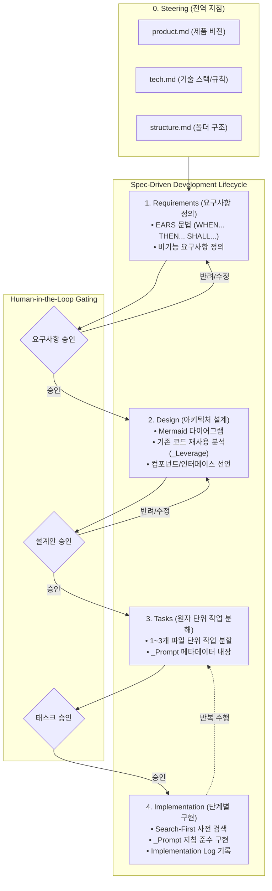
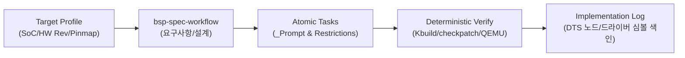

코드 자동완성을 넘어 자율적으로 도구를 실행하고 소스코드를 수정하는 **Agentic AI(에이전틱 엔지니어링)**가 본격화되면서, 개발 현장에서는 새로운 유형의 실패 패턴이 빈번하게 목격되고 있습니다.

단순한 스크립트 작성이나 1회성 함수 구현에서는 놀라운 생산성을 보이지만, 수십 개 파일이 얽힌 복잡한 저장소에 에이전트를 투입하면 다음과 같은 현상이 발생합니다:
- **컨텍스트 소실(Context Drift)**: 대화 세션이 길어지면서 초기 요구사항과 설계 제약조건을 잊어버리고 엉뚱한 방향으로 코드를 수정함.
- **설계 없는 즉흥 구현(Vibe Coding)**: 인터페이스와 아키텍처 정의 없이 즉흥적으로 코드를 짜다가 결합도(Coupling)가 폭발함.
- **중복 구현(Re-inventing the Wheel)**: 이미 프로젝트 내에 존재하는 유틸리티나 API를 찾지 못하고 비슷한 함수를 새로 만듦.
- **완료 판단의 모호함**: 명확한 검증 기준(Success Criteria)이 없어 대충 끝났다고 착각하고 작업을 종료함.

이러한 문제를 해결하기 위해 최근 AI 엔지니어링 진영에서 주목받는 접근법이 바로 **Spec-Driven Development (SDD, 명세 기반 개발)**입니다. 

본 글에서는 오픈소스 진영에서 대표적인 SDD 구현체로 평가받는 Pimzino의 [`spec-workflow-mcp`](https://github.com/Pimzino/spec-workflow-mcp)의 내부 설계를 심층 해부하고, 이를 **물리적 제약과 빌드 비용이 극도로 높은 Android/Linux BSP(Board Support Package) 엔지니어링**에 어떻게 접목할 수 있는지 분석합니다.

---

## 1. `spec-workflow-mcp` 아키텍처와 SDD 생애주기

`spec-workflow-mcp`는 본래 Claude Code 전용 워크플로우 템플릿(`claude-code-spec-workflow`)으로 시작했으나, 멀티 에이전트 호환성과 실시간 관측성을 확보하기 위해 **Model Context Protocol (MCP)** 서버 형태로 전면 재설계된 도구입니다.

이 프레임워크의 핵심 철학은 **"에이전트에게 한 줄의 코드도 바로 짜게 하지 말고, 엄격한 4단계 게이트(Gate)를 통과하게 만든다"**는 것입니다.



### 디렉터리 기반 상태 관리 (`.spec-workflow/`)
프레임워크는 외부 DB 없이 프로젝트 루트의 `.spec-workflow/` 디렉터리 내 정형화된 마크다운 파일로 전체 상태를 관리합니다:
- **`steering/`**: 프로젝트 전역 규칙 (`product.md`, `tech.md`, `structure.md`). 모든 스펙 작성 시 참조됨.
- **`specs/<feature-name>/`**:
  - `requirements.md`: 비즈니스 요구사항 및 기능 명세
  - `design.md`: 기술 아키텍처 및 재사용 계획
  - `tasks.md`: 상태 체크박스(`[ ]`, `[-]`, `[x]`)가 포함된 작업 목록
  - `Implementation Logs/`: 태스크 완료 시마다 누적되는 산출물 마크다운 로그
- **`approvals/`**: 단계별 사람 승인 요청 및 결과 JSON

---

## 2. 핵심 엔지니어링 패턴 3선 심층 분석

저장소 소스코드를 분석하면서 확인한, 에이전트 엔지니어링에 즉시 차용할 수 있는 3가지 결정적 패턴입니다.

### 패턴 1: EARS 문법 기반의 무모호 요구사항 정의
에이전트에게 자연어로 요구사항을 주면 자의적으로 해석하여 누락이나 과잉 구현(Over-engineering)이 발생합니다. `spec-workflow-mcp`는 **EARS (Easy Approach to Requirements Syntax)** 템플릿을 강제합니다:

```markdown
### Requirement 1: 센서 전원 제어
**User Story:** 시스템 엔지니어로서, 슬립 모드 진입 시 자이로 센서 LDO를 차단하여 대기 전력을 절감하고 싶다.

#### Acceptance Criteria (수용 조건)
1. WHEN 시스템이 suspend 상태로 전이될 때 THEN 드라이버는 sensor_power_down()을 호출해야 한다(SHALL).
2. IF 센서 데이터 트랜잭션이 진행 중인 경우 THEN 전송이 완료될 때까지 전원 차단을 최대 10ms 대기해야 한다(SHALL).
3. WHEN resume 이벤트가 발생하고 전원이 복구되면 THEN 5ms 이내에 센서 ID 레지스터를 검증해야 한다(SHALL).
```
`WHEN ... THEN ... SHALL ...` 규격은 에이전트가 나중에 테스트 코드를 작성하거나 수용 여부를 검증할 때 참/거짓을 이진 판정(Binary Decision)할 수 있게 해줍니다.

---

### 패턴 2: `_Prompt` 메타데이터 내장형 태스크 분해
가장 독창적이고 강력한 패턴은 `tasks.md`의 구조입니다. 단순히 할 일만 나열하는 것이 아니라, **에이전트가 그 태스크를 수행할 때 로드할 프롬프트를 마크다운 메타데이터로 사전 주입**해 둡니다.

```markdown
- [ ] 1. PMIC LDO 레귤레이터 제어 드라이버 구현
  - File: drivers/power/pmic_ldo.c
  - Purpose: 센서 전원 라인(LDO9) On/Off 및 전압 스위칭 로직 구현
  - _Leverage: drivers/power/pmic_core.c, include/linux/regulator/driver.h
  - _Requirements: 1.1, 1.2
  - _Prompt: Role: Linux Kernel Power Management Engineer | Task: Implement LDO regulator enable/disable callback functions according to requirement 1.1, leveraging existing core helpers from drivers/power/pmic_core.c | Restrictions: Do not acquire mutex inside interrupt context, ensure regulator status register is read back to confirm ramp-up, follow kernel coding style | Success: Driver compiles without warnings, regulator_enable() transitions voltage within 2ms, checkpatch.pl reports 0 errors
```

#### 이 패턴의 장점:
1. **역할(Role)과 제약(Restrictions)의 명시**: "Do not acquire mutex in interrupt context"와 같은 실수를 사전에 차단합니다.
2. **참조 코드(`_Leverage`) 고정**: 엉뚱한 라이브러리를 만들지 않고 기존 코드를 재사용하도록 경로를 못 박습니다.
3. **독립적 실행 가능성**: 대화 세션이 리셋되더라도 에이전트는 해당 태스크의 `_Prompt` 한 줄만 읽고도 완벽한 맥락을 파악할 수 있습니다.

---

### 패턴 3: Search-First 아키텍처와 `Implementation Logs`
대규모 에이전트 프로젝트에서 발생하는 가장 큰 낭비는 **이미 만들어진 함수나 엔드포인트를 모르고 또 만드는 것**입니다.

`spec-workflow-mcp`의 `implement-task` 프롬프트는 구현을 시작하기 전, **반드시 기존 `Implementation Logs/` 디렉터리를 검색(Grep/Ripgrep)하도록 강제**합니다:

```text
[실행 전 규칙]
1. BEFORE writing any code, search implementation logs to understand existing artifacts:
   grep -r "regulator_register" ".spec-workflow/specs/<name>/Implementation Logs/"
2. Check existing symbols, structures, and integration points.
3. If you find existing code that does what the task asks, leverage it instead of recreating.
```

태스크가 완료되면 에이전트는 `log-implementation` 도구를 호출하여 생성된 심볼(함수, 클래스, API, 변경 파일, 추가/삭제 라인 수)을 정형 마크다운 로그로 남겨야만 태스크를 완료(`[x]`)할 수 있습니다. 이것이 바로 세션이 끊겨도 유지되는 **지식 베이스(Persistent Knowledge Base)** 역할을 합니다.

---

## 3. BSP / 임베디드 도메인 관점에서의 비판적 평가

`spec-workflow-mcp`는 웹 서비스 및 클라우드 풀스택 애플리케이션 개발에는 탁월하지만, **Android/Linux BSP 및 시스템 반도체 엔지니어링** 환경에 그대로 적용하기에는 분명한 간극(Gap)이 존재합니다.

| 구분 | `spec-workflow-mcp` (웹/클라우드 기준) | BSP / 임베디드 엔지니어링의 현실 |
| :--- | :--- | :--- |
| **산출물 대상 (Artifacts)** | REST API Endpoint, React Component | Device Tree 노드, 레지스터 비트맵, Sysfs 노드, ioctl |
| **실행 및 검증 환경** | 로컬 Node.js, Jest, 브라우저 렌더링 | 교차 컴파일(Cross-compile), Fastboot/ADB 플래싱, 물리 보드 UART |
| **실패 비용** | 브라우저 콘솔 에러, 서버 재시작 | **타깃 보드 브릭(Hard Brick), HW 쇼트, 부팅 루프** |
| **사전 제약 (Context)** | `tech.md` (언어, DB, 프레임워크) | **Target Profile (SoC 파트명, 보드 HW Rev, PMIC 레귤레이터 맵)** |
| **운영 오버헤드** | 백그라운드 Node/Express/Vite 대시보드 상시 구동 | CLI/SSH 터미널 중심의 고속 빌드 파이프라인 |

### 결정적인 누락: 하드웨어 진실(Single Source of Truth)
웹에서는 DB 스키마나 API 명세가 기준이지만, BSP에서는 **물리적 하드웨어 스펙(Target Profile)**이 최상위 계약이어야 합니다. 에이전트가 임의로 DTS의 I2C 주소나 PMIC LDO 번호를 가정하고 코딩하면 보드가 손상될 수 있습니다. 따라서 SDD 워크플로우 맨 앞단에 **하드웨어 프로파일 주입 단계**가 반드시 결합되어야 합니다.

---

## 4. 우리의 적용 전략: 도구 종속 탈피와 스킬화

`spec-workflow-mcp` 도구 패키지(Node.js MCP 서버)를 그대로 설치해 백그라운드에 띄우는 것은 임베디드 환경에 불필요한 의존성을 늘립니다. 

우리가 취해야 할 최적의 엔지니어링 전략은 **이 도구의 뛰어난 사상(SDD 루프 + _Prompt 메타데이터 + Search-First 로그)을 흡수하여 BSP 맞춤형 에이전트 스킬(`bsp-spec-workflow`)로 재구성하는 것**입니다.



### BSP 맞춤형 SDD 설계 체크포인트
1. **DTS/드라이버용 `tasks-template.md` 도입**:
   - `_Prompt`에 커널 락킹 규칙(Spinlock vs Mutex), 메모리 할당 제약(`GFP_KERNEL` vs `GFP_ATOMIC`), 디바이스 트리 바인딩 명세 포함.
2. **Search-First 심볼 레지스트리**:
   - 에이전트가 새로운 드라이버를 구현하기 전, 커널 내 기존 헬퍼 함수(`devm_*`, `of_property_*`, `regmap_*`) 검색을 선행하도록 프롬프트 레일 구축.
3. **결정론적 검증 게이트(Deterministic Gate)**:
   - 사람의 수동 클릭 승인뿐만 아니라, `checkpatch.pl` 린트 통과, Kbuild 성공, QEMU/Cuttlefish 런타임 프로브 성공을 태스크 완료(`[x]`)의 필수 전제조건으로 결합.

---

## 5. 마치며

AI 에이전트를 실무에 투입할 때 가장 경계해야 할 것은 **"모델의 일반 지능에 기대어 자율성을 무한정 부여하는 것"**입니다. 복잡한 시스템일수록 에이전트는 쉽게 탈선합니다.

`spec-workflow-mcp`가 보여준 해법은 명확합니다. **"에이전트가 코드를 쓰기 전에 질문하게 만들고, 설계를 검증받게 만들며, 작은 단위로 나누어 지침을 따르게 만드는 것"**입니다.

이러한 Spec-Driven 체계를 BSP 엔지니어링의 **Target Profile** 및 **결정론적 안전 검증 하네스**와 결합할 때, 우리는 비로소 보드를 브릭시키지 않는 안전하고 강력한 AI-Native BSP 개발 환경을 구축할 수 있습니다.
