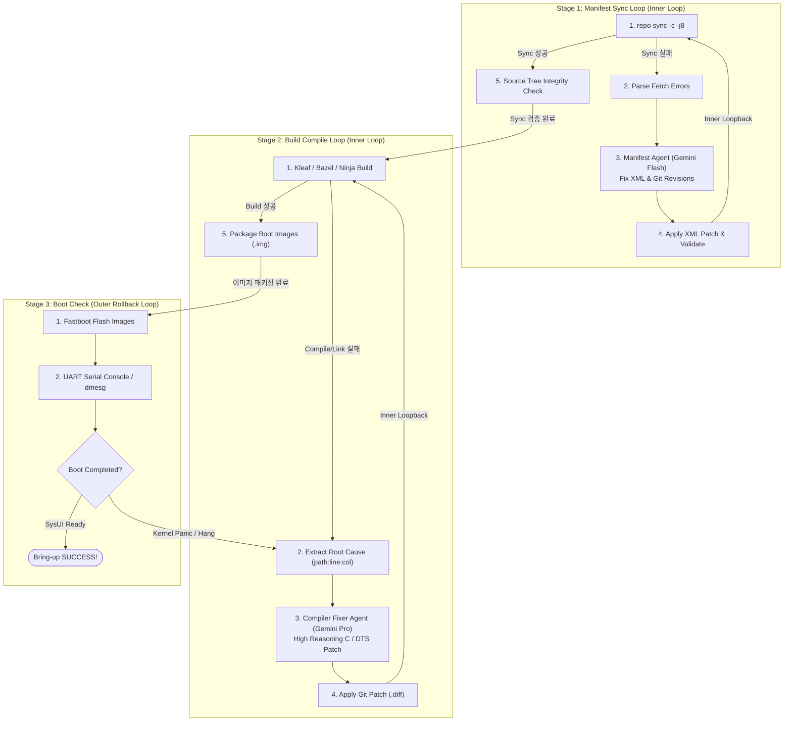
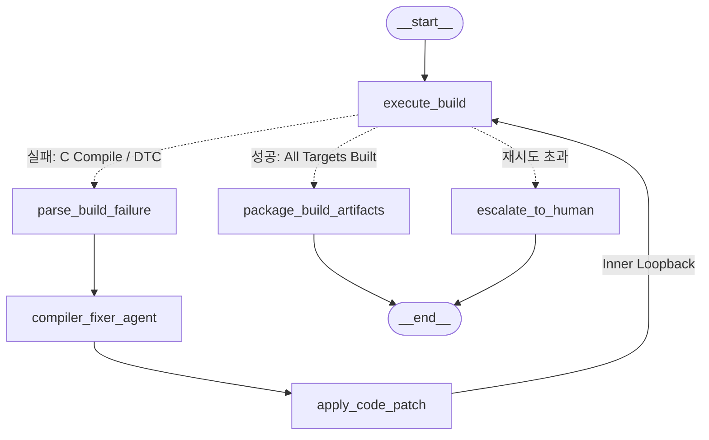

지난 글([Android BSP의 Agentic Shift (1) — 정의와 생태계 흐름](/posts/agentic-bsp-shift-definition-and-landscape/))에서 우리는 단순한 코드 작성을 돕는 L1~L2 수준을 넘어, 저장소 맥락을 파악하고(L3), 스스로 빌드-배포-테스트-진단-수정의 피드백 루프를 완결하는 **L4 Closed-Loop Execution**의 필요성과 5계층 스킬 표준 구조를 살펴보았습니다.

하지만 이를 실제 개발 현장에 구현하려고 할 때, 엔지니어는 즉각적인 현실적 벽에 부딪힙니다:
1. **대용량 파일과 시스템 바이너리**: AOSP의 `repo sync` 실패 로그, 수만 줄(50MB+)에 달하는 Ninja/Kleaf 빌드 로그, Fastboot 플래시용 부트 이미지(`boot.img`), 시리얼 UART/dmesg 덤프를 일반 LLM 프롬프트나 텍스트 데이터베이스에 그대로 밀어 넣으면 메모리가 폭발하거나 컨텍스트가 망가집니다.
2. **연쇄적 수정(Cascading Fixes)과 롤백**: BSP 포팅은 "A를 고치면 B에서 터지고, B를 고치면 C에서 터지는" 연쇄적 시행착오의 연속입니다. 매 시도마다 대용량 파일을 무한정 저장하면 디스크가 감당되지 않으며, 특정 실패 시점에서 안전하게 이전 상태로 되돌아가는 제어 체계가 필수적입니다.
3. **보안과 폐쇄망 제약**: 실리콘 벤더와 OEM의 BSP 코드는 엄격한 NDA에 묶여 있어 외부 클라우드 SaaS(LangSmith, 외부 호스팅 트레이서 등)에 소스나 로그를 전송할 수 없습니다. **100% 로컬 온프레미스(Self-Hosted)** 환경이 강제됩니다.

본 글에서는 **상태 머신 오케스트레이션 엔진인 `LangGraph`**와 **대용량 아티팩트 및 엔지니어링 관측성 플랫폼인 `MLflow 3`**를 결합하여, Android BSP 개발자의 핵심 업무인 **브링업(Bring-up) 프로세스를 계층적 자가 치유 파이프라인으로 모델링하고 실제 구현·검증한 아키텍처**를 공유합니다.

---

## 1. 도구 선정: 왜 Langfuse가 아닌 `MLflow 3`인가?

에이전트 관측성(Observability) 생태계에는 최근 Langfuse, Arize Phoenix, LangSmith 등 다양한 오픈소스 및 상용 툴이 존재합니다. 하지만 시스템 엔지니어링과 BSP 도메인의 물리적 특수성을 대입하면 선택지는 명확히 갈립니다.

| 평가 항목 | 일반 SaaS 관측 도구 (Langfuse 등) | LangGraph Studio 단독 | **MLflow 3 + LangGraph (채택)** |
| :--- | :--- | :--- | :--- |
| **핵심 목적** | 웹 서비스 LLM 토큰/비용 추적 및 프롬프트 관리 | 그래프 노드 시각화 및 개발 디버깅 | **대용량 시스템 아티팩트 관리 & 엔지니어링 Trace** |
| **대용량 바이너리/로그 보관** | ❌ 부적합 (텍스트 메타데이터 중심) | ❌ 불가 (상태 보관 메모리 제한) | **✔ 완벽 지원 (Run 단위 50MB+ 로그, diff, .img 보관)** |
| **온프레미스/폐쇄망 구동** | △ Docker Compose 등 복잡한 인프라 필요 | ❌ 클라우드 락인 (`smith.langchain.com` 의존) | **✔ 단일 Python 가상환경 + SQLite로 즉시 셀프호스팅** |
| **LangGraph 네이티브 연동** | △ 커스텀 콜백 핸들러 작성 필요 | ✔ 네이티브 | **✔ `mlflow.langchain.autolog()` 1줄로 완벽 계측** |
| **Git Diff 및 아티팩트 뷰어** | ❌ 미지원 | △ 중간 State 텍스트 확인 수준 | **✔ `.diff`, `.log`, `.html` 파일 자체 뷰어 및 다운로드** |

일반 웹 챗봇과 달리, BSP 에이전트는 **"수십 MB의 컴파일 로그와 수 메가바이트의 커널 패치, Fastboot 이미지를 안전하게 관리하면서 그래프 실행 흐름을 추적"**해야 합니다. 따라서 MLOps의 묵직한 데이터 관리 능력과 LLM Tracing을 결합한 **MLflow 3**가 최적의 백본이 됩니다.

```
┌────────────────────────────────────────────────────────┐
│  [ LangGraph ]  =  Brain & Control Engine             │
│  - 다중 루프 제어 (Manifest Loop, Build Loop, Boot Loop) │
│  - 상태 전이 관리 (State Management, Conditional Edges)│
│  - Human-in-the-Loop (패치 적용 전 개발자 승인 대기)   │
└──────────────────────────┬─────────────────────────────┘
                           │ 런타임 이벤트 & 로그 스트리밍
                           ▼
┌────────────────────────────────────────────────────────┐
│  [ MLflow 3 ]  =  Agentic Ops & Artifact Platform      │
│  - 대용량 아티팩트 (50MB+ Ninja 로그, dmesg, boot.img) │
│  - 계층적 트레이스 (Span Tree, Waterfall Timeline)     │
│  - 노드별 LLM 모델 / 추론 강도(Reasoning Effort) 기록  │
│  - 100% 온프레미스 구동 (SQLite 백엔드)                │
└────────────────────────────────────────────────────────┘
```

---

## 2. BSP Bring-up의 계층적 상태 머신 (Hierarchical State Machine)

Android BSP 개발자의 Bring-up 여정은 크게 **3개의 단계(Stage)**로 구성되며, 각 단계별 **내부 루프(Inner Loop)**와 실패 시 이전 빌드로 되돌아가는 **외부 루프(Outer Loop)**가 유기적으로 맞물려 있습니다.



---

## 3. Stage 1: Manifest Sync 자가 치유 파이프라인 구현

OEM 베이스라인 소스 수령 후 가장 빈번하게 발생하는 문제는 upstream remote URL 변경, 존재하지 않는 git revision 태그 지정, 그리고 `local_manifests` 간의 프로젝트 경로 충돌입니다.

### 3.1 상태 정의 및 에이전트 설계
Manifest XML과 git 브랜치 교정은 복잡한 심층 추론보다는 정확한 패턴 매칭과 빠른 속도가 요구되므로, **`gemini-2.5-flash`** 모델을 전문 에이전트로 배치했습니다.

```python
class ManifestSyncState(TypedDict):
    manifest_path: str
    sync_attempt: int
    max_retries: int
    sync_success: bool
    failed_projects: List[str]
    error_summary: str
    sync_log_artifact_path: str
    patch_diff: str
    workflow_logs: List[str]
```

### 3.2 실행 검증 및 MLflow 결과
실제 결함 상황(존재하지 않는 `android14-release-invalid` 브랜치 및 404 URL)을 주입하고 파이프라인을 구동한 결과:

1. **Attempt 1**: `repo sync` 실패 감지 &rarr; 전체 에러 콘솔 로그를 MLflow Artifact(`sync_logs/repo_sync_attempt_1.log`)로 격리 보관.
2. **진단 및 패치 생성**: 에이전트가 에러 로그를 읽고 `default.xml`의 올바른 GKI 커널 브랜치(`refs/heads/android14-5.15-gki`)와 정상 레포지토리 경로로 치환하는 `manifest_fix_attempt_1.diff` 생성.
3. **XML 문법 검증 및 루프백**: `xml.etree.ElementTree` 문법 검증 통과 후 Attempt 2로 루프백 수행.
4. **Attempt 2**: `repo sync` 100% 성공 &rarr; 필수 소스 트리 무결성 검증 후 Stage 2로 인계.

---

## 4. Stage 2: Build Compile 2단계 자가 치유 파이프라인 구현

빌드 단계는 컴파일러 에러의 문맥을 깊이 있게 이해하고 정밀한 C 코드 및 DeviceTree(DTS) 패치를 생성해야 하므로, **`gemini-2.5-pro` (Reasoning Effort: High)**를 전담 에이전트로 할당했습니다.

### 4.1 실제 현업 시나리오 재현: 2단 연쇄 결함(Cascading Errors)
1. **1차 결함 (Clang C 컴파일러 오류)**:
   * 에러: `drivers/soc/bsp/power_mgr.c:7:5: error: implicit declaration of function 'pmic_reg_write_safe'`
   * 원인: 커널 버전 업그레이드로 인한 헤더 미포함
2. **2차 결함 (DTC Device Tree 컴파일러 오류)**:
   * C 코드를 고치고 나자 숨어있던 디바이스 트리 오류 노출: `Reference to non-existent node or label "pmic_spmi"`
   * 원인: SoC SPMI 버스 라벨 명칭 불일치 (`pmic_spmi` vs `pmic_spmi_bus`)



### 4.2 실행 및 2단계 자동 치유 결과
* **Attempt 1**: Clang 에러 감지 &rarr; `compiler_fixer_agent`가 `#include <linux/mfd/pmic_core.h>`를 삽입하는 `patch_attempt_1.diff` 생성 및 적용.
* **Attempt 2**: 재빌드 도중 DTC 구문 에러 감지 &rarr; `compiler_fixer_agent`가 SPMI 버스 라벨을 `<&pmic_spmi_bus>`로 교정하는 `patch_attempt_2.diff` 생성 및 적용.
* **Attempt 3**: 모든 타깃 빌드 완료 &rarr; `boot.img`, `dtbo.img`, `vendor_boot.img` 바이너리 생성 후 MLflow Artifacts에 패키징 등록.

---

## 5. 연쇄적 수정(Cascading Fixes)과 아티팩트 라이프사이클 전략

BSP 브링업은 수십 번의 Retry가 일상적으로 발생합니다. 이때 모든 시도의 거대한 Ninja 로그와 중간 바이너리를 무작정 보관하면 디스크와 관측 UI가 쓰레기 데이터로 마비됩니다. 

우리는 이를 해결하기 위해 **"Trace는 상세히 남기되, Artifact는 최종본 위주로 압축한다"**는 3대 보관 전략을 수립했습니다:

| 구분 | 중간 재시도 (Attempts 1 ~ N-1) | 최종 성공 (Final Success) |
| :--- | :--- | :--- |
| **추론 Trace** | **모두 기록** (각 시도별 에러 문맥, 모델 판단 근거 보존) | **전체 라이프사이클 통계 집계** |
| **빌드 로그 (Ninja)** | **최신 1회분만 롤링 덮어쓰기** (`latest_build_failure.log`) | **성공 요약 로그**만 영구 보관 |
| **소스 패치 (.diff)** | 에이전트 전용 로컬 Git 브랜치에 커밋으로 누적 | **최종 통합 패치(`final_squash.diff`) 1개만 등록** |
| **부트 이미지 (.img)** | **저장하지 않음** (임시 디렉토리에서 소멸) | **최종 1세트만 Artifact 등록 및 배포** |

---

## 6. 관측성 및 2D 인터랙티브 아키텍처 뷰

구축된 시스템은 브라우저에서 **`http://localhost:5000`** 접속을 통해 다음과 같은 실시간 증거(Evidence)를 제공합니다:

1. **Traces 워터폴 뷰**:
   * 각 노드의 호출 순서, 소요 시간(Latency), 입출력 State, 토큰 소모량을 계층적 트리로 확인.
   * `compiler_fixer_agent` 노드 클릭 시 어떤 에러 라인을 읽고 어떤 모델(`gemini-2.5-pro`, `reasoning_effort=high`)이 호출되었는지 1초 만에 확인.
2. **Artifacts 2D 인터랙티브 그래프**:
   * LangGraph의 `workflow.get_graph().draw_mermaid()`를 HTML 아티팩트(`diagrams/graph_architecture.html`)로 자동 렌더링하여, 별도의 상용 툴 없이도 브라우저 내부에서 노드 전이와 루프백 구조를 시각적으로 직접 확인 가능.

---

## 7. 결론 및 향후 과제: Stage 3와 Human-in-the-Loop (HITL)

이번 구현을 통해 우리는 **"결정론적 상태 머신(LangGraph) + 대용량 시스템 관측성(MLflow 3)"**의 조합이 Android BSP Bring-up이라는 초거대 시스템 소프트웨어 엔지니어링에 완벽하게 부합함을 입증했습니다.

다음 단계에서는 완성된 부트 이미지를 실제 보드(DUT) 또는 가상 환경(Cuttlefish)에 Fastboot으로 플래싱하고, UART 시리얼 콘솔의 Early Hang / Kernel Panic을 진단하여 Stage 2로 롤백하는 **Stage 3 (Boot Check Outer Loop)**와, 민감한 레지스터 수정 시 개발자의 원클릭 승인을 대기하는 **LangGraph Checkpointer 기반의 Human-in-the-Loop(HITL)** 체계를 연결할 예정입니다.
